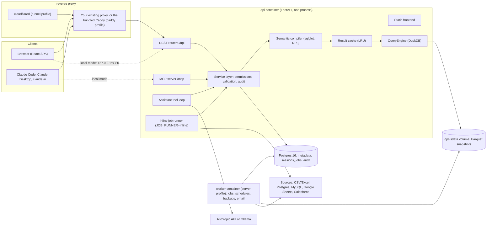
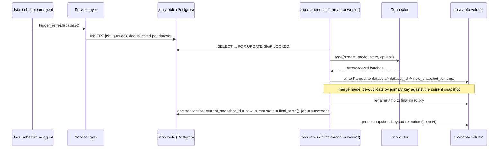
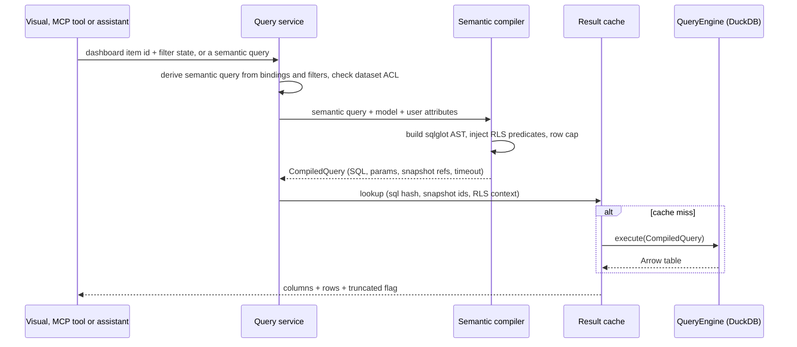
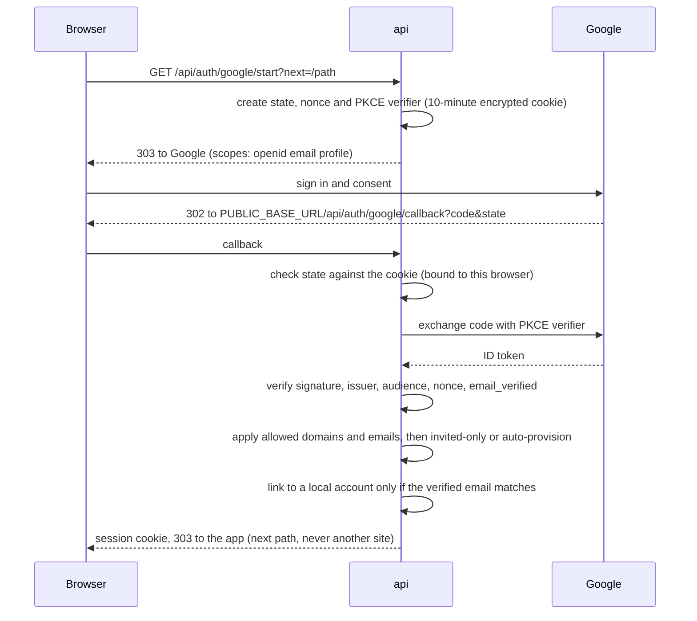
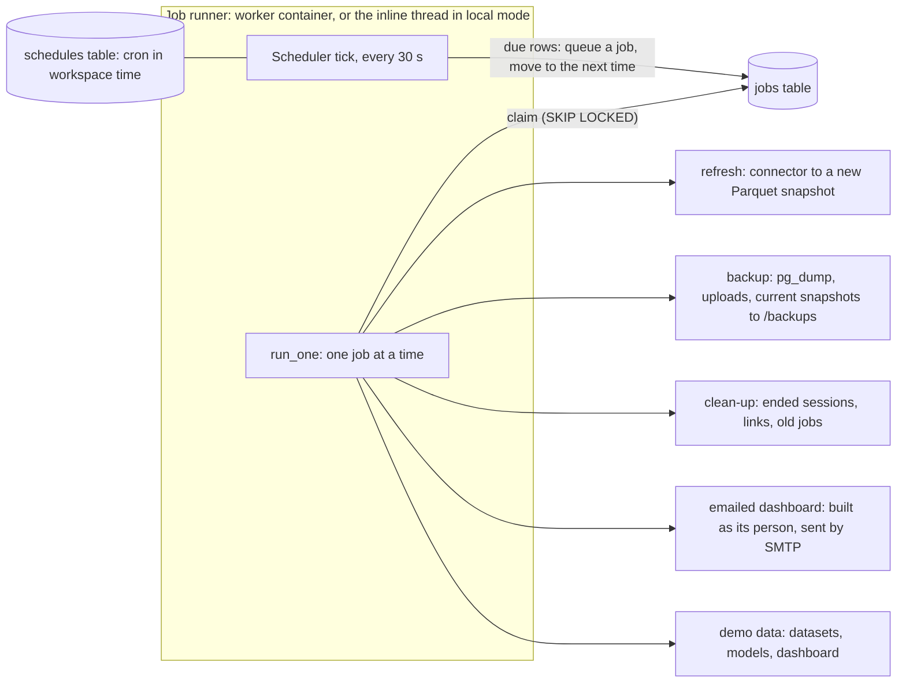

# Opsis architecture

Scope: the plan agreed in Milestone 0. `BUILD_BRIEF.md` is the spec; this file shows how the pieces fit. Decisions and deviations are in `DECISIONS.md`.

## 1. Components



Rules that keep this simple:

- **One service layer.** REST routers, MCP tools and assistant tools are thin adapters over `opsis.services`. Permission checks, flag checks, validation and audit live there, once.
- **One image.** `api` and `worker` run the same image with different commands. Local mode has no worker: jobs run in a background thread inside `api`.
- **Postgres holds metadata only.** Analytical data lives as Parquet on the `opsisdata` volume and is queried by DuckDB in-process.
- **Plugins are folders.** Connectors in `backend/opsis/connectors/<id>/` (or `plugins/connectors/<id>/`, or an entry point), visuals in `frontend/src/visuals/<id>/`. The Docker build copies visual manifests into the backend image so the API and MCP server can list and validate them.
- **Flags are parsed once** by the settings module. Disabled features are not mounted (routes 404, MCP tools not registered); `GET /api/config` tells the frontend what to show.

## 2. Data flow: refresh



- The pointer swap and the cursor state commit in the same transaction, so a failed refresh changes nothing that readers or the next refresh can see.
- Snapshots are immutable. Readers resolve the snapshot id at query start and keep reading those files even if a swap happens mid-query. `SNAPSHOT_RETENTION` is at least 2, so the snapshot a reader started on always survives the next swap.
- Both runner modes execute the same `run_one()` function in `opsis/jobs/worker.py`. Only the loop around it differs: a thread in the api (`inline`) or the worker container's main loop (`worker`).
- How each mode builds the new snapshot (`opsis/storage/snapshots.py`):
  - **full**: the rows read are the snapshot.
  - **append**: the previous files are hard-linked into the new directory and the new rows are added as extra files. Only rows with a cursor value above the saved one are read.
  - **merge**: rows changed since the saved cursor are read, then DuckDB combines them with the previous snapshot, keeping the newest row per primary key. Rows deleted in the source are not removed; a full rebuild does that.
- The first refresh of any dataset, and a "full rebuild", read everything.
- Values that do not fit their column's type (a MySQL zero date, text in a number column) are stored as NULL and counted by the conversion layer every connector builds its batches with (`opsis/connectors/convert.py`, ADR-027). Invalid dates follow the connection's `invalid_dates` setting. A dataset's column types set by hand are applied to the batches after the connector, before the snapshot is written. The report (per column: how many, why, samples; type suggestions) is kept with the snapshot and is the job's `dataQuality` result.
- Secrets: connection settings are split by the connector's schema. Fields marked `x-secret` are encrypted with Fernet (`ENCRYPTION_KEY`) into one column; the rest is plain JSON. The API returns only the names of secret fields that have a value.

## 3. Data flow: query



- Viewers never send a semantic query for a dashboard: they send an item id plus filter values, and the backend derives the query from the **published** spec (M4). Editors and the agent may send semantic queries directly (`POST /api/query`, later `run_query`), still through the compiler.
- User input only ever becomes sqlglot literals or identifiers resolved against the model. Model expressions (`expr`, RLS filters, segments) are parsed with sqlglot and restricted to an allow-list of expression nodes; `{measure}` and `{{ user.attributes.x }}` placeholders are substituted as AST nodes, never as text.
- A user with no matching value for an RLS attribute gets a predicate that is false (deny by default).
- The engine opens a short-lived DuckDB connection per query, read-only over Parquet, with a memory limit and a watchdog that interrupts at the timeout.

The compiled SQL always has this shape. Row-level security sits inside the subquery that reads each dataset:

```sql
SELECT "gifts"."fund" AS "gifts.fund",
       CAST(DATE_TRUNC('quarter', ("gifts"."gift_date") - INTERVAL '6' MONTH) + INTERVAL '6' MONTH AS DATE) AS "gifts.gift_date",
       SUM("gifts"."amount") AS "gifts.total_amount"
FROM (SELECT * FROM READ_PARQUET('<snapshot>/part-*.parquet') AS "gifts"
      WHERE ("gifts"."region" IN ('VIC'))) AS "gifts"
LEFT JOIN (SELECT * FROM READ_PARQUET('<snapshot>/part-*.parquet') AS "donors") AS "donors"
       ON "gifts"."donor_id" = "donors"."id"
WHERE "gifts"."gift_date" >= CAST('2025-07-01' AS DATE) AND "gifts"."gift_date" < CAST('2026-07-01' AS DATE)
GROUP BY 1, 2
ORDER BY "gifts.gift_date" ASC
LIMIT 501
```

Code map: `opsis/semantic/model.py` (parse, validate, starter), `expressions.py` (allow-list), `compiler.py`, `calendar.py`; `opsis/query/duckdb_engine.py` (engine and cache); `opsis/services/models.py` and `query.py`; `opsis/api/semantic.py`. Details and rules are in ADR-019.

### Calendar and financial years

Relative ranges (`last_12_months`, `this_fiscal_year`) and grains (`week`, `fiscal_quarter`) depend on three workspace settings: `WORKSPACE_TIMEZONE`, `WEEK_START` and `FISCAL_YEAR_START_MONTH`. The rules are defined once in `opsis/semantic/calendar.py` (ADR-012):

- The compiler resolves a relative range to literal dates using "today" in the workspace timezone, so the SQL and the cache key contain real dates.
- Every grain returns the start date of its period. A fiscal year is named after the year it ends in (July start: FY2027 is 1 July 2026 to 30 June 2027). The frontend formats labels from the date plus the `calendar` block of `/api/config`.

## 4. Dashboard writes and live updates

1. A write arrives as a full spec (UI) or as JSON Patch plus `base_version` (agent).
2. The patch is applied to the base version. If `base_version` is not the latest, return 409.
3. Validation runs in two phases: structural (`spec/dashboard.schema.json`), then semantic (unique ids, visual exists, bindings satisfy manifest roles, config matches `configSchema`, fields exist in the model, items fit the grid). Errors carry JSON pointer paths.
4. A new immutable `dashboard_versions` row is inserted; the audit log records agent writes.
5. The dashboard SSE channel emits `version_created`. Open editors reload the draft and show "Updated by assistant. Undo".

Draft is the latest version. Published is a pointer to one version. Viewers and share links only read the published pointer.

**Built (M4 and M5):** all five steps. The UI saves full specs; the agent sends JSON Patch through the MCP tool `patch_dashboard`. The event stream is `GET /api/dashboards/{id}/events`, fed by an in-process hub, and each tab ignores the events its own writes cause. The MCP server itself (transport, tools, tokens) is described in ADR-022.

**Reading a dashboard.** The browser asks for one item at a time: `POST /api/dashboards/{id}/data` with the item id and the view state (filter values, cross-filter selections, drill grains). The backend loads the spec (published for viewers, draft or an inline unsaved spec for editors), derives the semantic query from the item's bindings and the state, and runs it through the path in section 3, so RLS, the cache and the concurrency limit all apply. The browser never writes a query for a dashboard. Details are in ADR-021.

## 5. Auth flows

All modes resolve every request to a `Principal` (user id, role, groups, attributes, scopes) and run the same permission checks.

| Entry | How the principal is established |
|---|---|
| `AUTH_MODE=none` | Every request is the built-in admin. Startup refuses this mode unless the bind address is loopback. |
| Local login | `POST /api/auth/login` checks argon2id and the lockout table, creates a server-side session row, and sets an opaque HttpOnly cookie plus a CSRF token cookie. State-changing requests must echo the CSRF token in a header. |
| Google (`AUTH_MODE=full`) | See the diagram below. |
| MCP and API tokens | `Authorization: Bearer <PAT>`. The token is looked up by hash, checked for expiry and revocation, and the request runs as that user limited to the token scopes. An Authorization header never falls back to a session cookie. `MCP_AUTH=none` is accepted only on loopback with `AUTH_MODE=none`, and maps to the built-in admin. |
| Share link | The page `/s/<token>` calls `/api/public/links/<token>`: the token is looked up by hash and checked for expiry, revocation, a published version and the optional password (unlocked by an encrypted 12-hour cookie). It serves the published version read-only as a synthetic viewer carrying the attribute set chosen when the link was made (empty by default, so RLS denies) and never exempt from a rule. |



Bootstrap: on first start, `ADMIN_EMAIL` and `ADMIN_INITIAL_PASSWORD` create the first admin with a forced password change. Switching from `AUTH_MODE=none` to a sign-in mode switches the built-in admin off, which also stops its access tokens. Recovery without any admin: `python -m opsis reset-link <email>` on the server.

**Access (M6).** Dashboards belong to their owner and are shared with users, groups or everyone as viewers or editors; admins can do everything. Viewers see the published version only (title included); a viewer-role person shared as an editor is still a viewer. A dashboard someone cannot view answers 404. Datasets are open to everyone who builds unless restricted to admins and named users or groups; viewing a dashboard needs no dataset access, because the dashboard grants its own questions, with RLS applied as the viewer. All of this lives in `services/access.py` and is checked in the service layer, so REST, MCP and share links share it. Details in ADR-023.

**After the M6 review.** A dataset's owner (its creator) can restrict it, and only admins lift an admin's restriction. Only a dashboard's owner and admins change its sharing. A restricted dataset's data cannot reach people outside its list through a dashboard (sharing, share links, drafts, publishing) unless its owner or an admin allows it. Details in ADR-024.

**Google Sheets sign-in (after M8).** Not a sign-in to Opsis: a Google Sheets connection's own Google account, through the person's own OAuth client. Opsis builds the consent address (offline access, prompt=consent, PKCE, read-only scopes) and keeps the pending flow with the connection's encrypted secrets. Google sends the browser back either to Opsis's root (local mode, or a Web client that lists Opsis's address), whose page finishes the flow, or to a loopback address that does not load, whose address the person pastes into Opsis. Either way Opsis exchanges the code itself and keeps only the refresh token, encrypted. Details in ADR-026.

## 6. The assistant (M7)

The editor's Assistant tab sends the person's request to `POST /api/dashboards/{id}/assistant/messages`. The request runs as its own task in the api process and the response streams its progress as server-sent events.

```mermaid
sequenceDiagram
  participant P as Panel
  participant A as api (tool loop)
  participant M as Claude or Ollama
  participant T as MCP tools (as the person)

  P->>A: request, selected item
  A->>A: store it; add the context block (date, dashboard, selection, datasets)
  loop until the model answers without tools, or a budget runs out
    A->>M: instructions, tools, the whole history (streamed)
    M-->>A: text, progress notes, tool calls
    A-->>P: delta and step events as they arrive
    A->>T: each call, checked against its schema, with the person's access
    T-->>A: result (rows and length capped)
    A-->>P: the stored step, with the version it saved
  end
  A-->>P: done: tokens, steps, time, versions before and after
```

- Providers keep the history in their own format and the loop sends it back unchanged (ADR-025). The tools are the MCP tools, so permissions, RLS, validation and the audit of agent writes are the same as for MCP.
- Every dashboard change is a new version by the assistant; open editors reload it through the live-update channel of section 4. Undo in the panel restores the version before a step, or before the whole request.
- Conversations, the history and the panel's entries are in Postgres (`assistant_*` tables); requests in progress are in the api process (`assistant/runs.py`).

## 7. Schedules, backups and email (M8)



- Everything that runs on its own is a row in `schedules` (ADR-026) and becomes an ordinary job, so it shows on the Jobs page and runs one at a time with everything else. That is also what keeps a backup consistent: no refresh can swap a snapshot during it.
- Email is sent by the request or job that makes it (an invitation by the api, an emailed dashboard by the runner) and is never stored.
- Restore is not a job: it is a command run while the api and worker are stopped (`python -m opsis restore <file> --yes`).

## 8. Contracts to review

| File | What it defines |
|---|---|
| `spec/semantic-query.schema.json` | The query shape, plus shared definitions (field reference, range, filter, sort) |
| `spec/semantic-model.schema.json` | A dataset's semantic model: dimensions, measures, segments, joins, RLS |
| `spec/dashboard.schema.json` | The dashboard spec, referencing the shared definitions |
| `spec/visual-manifest.schema.json` | A visual plugin manifest |
| `frontend/src/visuals/bar/manifest.json` | Example manifest |
| `backend/opsis/connectors/base.py` | `Connector` protocol and its data types |
| `backend/opsis/query/engine.py` | `QueryEngine` protocol and its data types |
