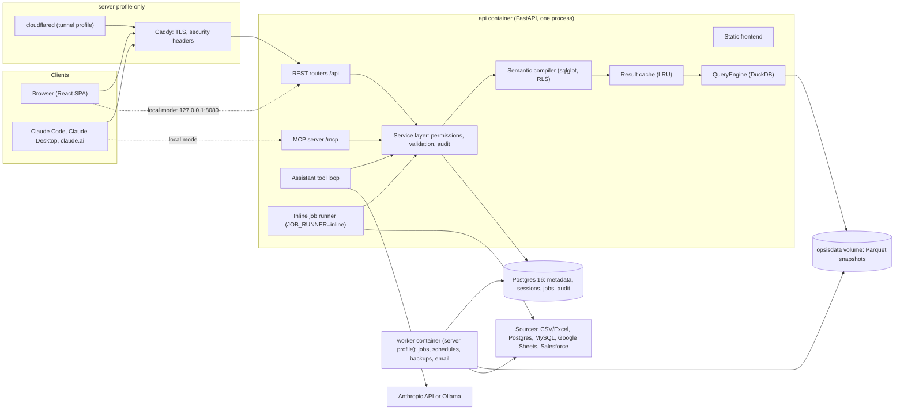
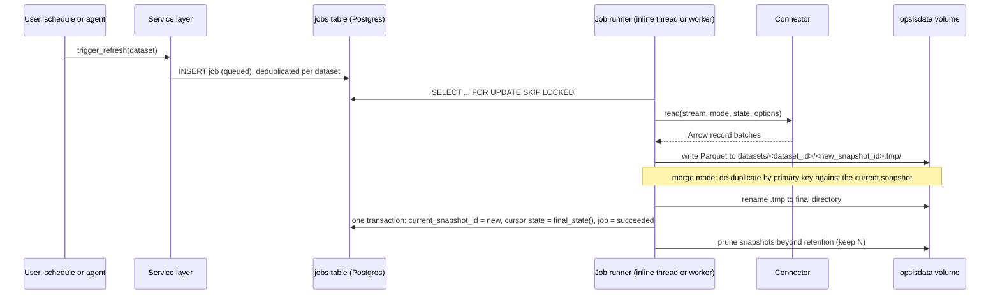
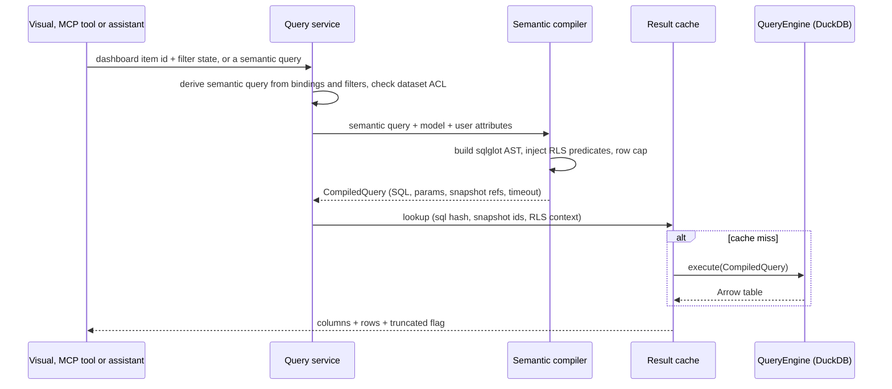
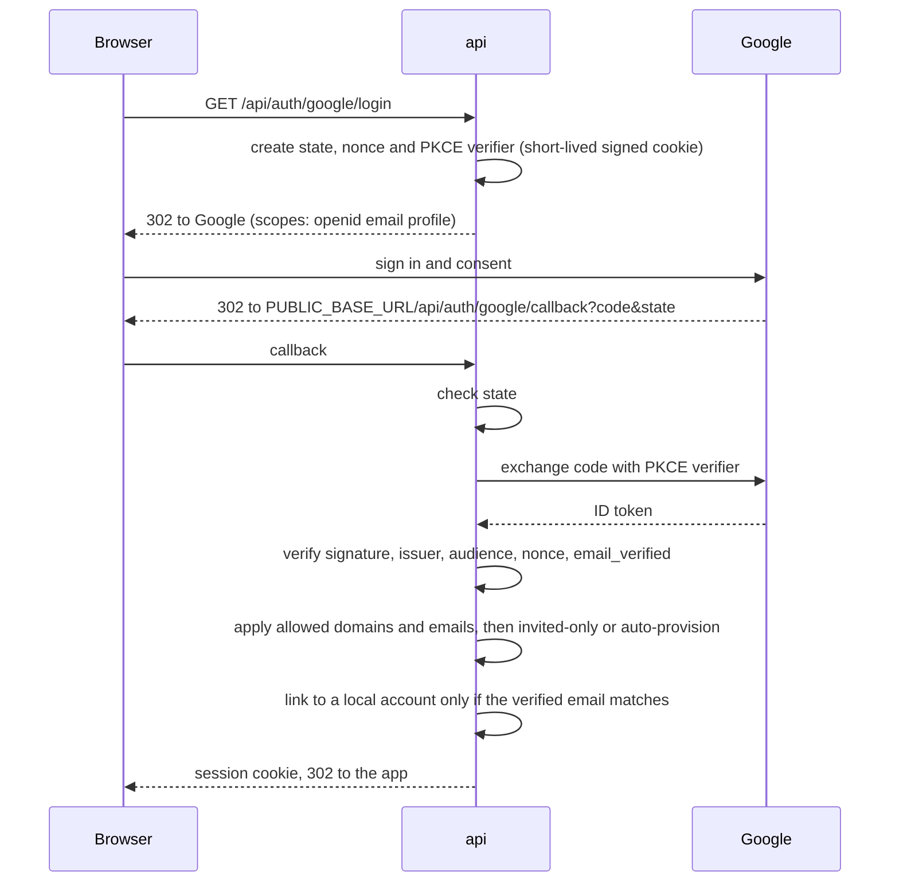

# Opsis architecture

Scope: the plan agreed in Milestone 0. `BUILD_BRIEF.md` is the spec; this file shows how the pieces fit. Decisions and deviations are in `DECISIONS.md`.

## 1. Components

Rules that keep this simple:

- **One service layer.** REST routers, MCP tools and assistant tools are thin adapters over `opsis.services`. Permission checks, flag checks, validation and audit live there, once.
- **One image.** `api` and `worker` run the same image with different commands. Local mode has no worker: jobs run in a background thread inside `api`.
- **Postgres holds metadata only.** Analytical data lives as Parquet on the `opsisdata` volume and is queried by DuckDB in-process.
- **Plugins are folders.** Connectors in `backend/opsis/connectors/<id>/` (or `plugins/connectors/<id>/`, or an entry point), visuals in `frontend/src/visuals/<id>/`. The Docker build copies visual manifests into the backend image so the API and MCP server can list and validate them.
- **Flags are parsed once** by the settings module. Disabled features are not mounted (routes 404, MCP tools not registered); `GET /api/config` tells the frontend what to show.

## 2. Data flow: refresh

- The pointer swap and the cursor state commit in the same transaction, so a failed refresh changes nothing that readers or the next refresh can see.
- Snapshots are immutable. Readers resolve the snapshot id at query start and keep reading those files even if a swap happens mid-query. Pruning skips snapshots newer than a grace period so in-flight queries are safe.
- Both runner modes execute the same `run_job()` function. Only the loop that claims jobs differs.

## 3. Data flow: query

- Viewers never send a semantic query for a dashboard: they send an item id plus filter values, and the backend derives the query from the **published** spec. Editors and the agent may send semantic queries directly (`run_query`), still through the compiler.
- User input only ever becomes sqlglot literals or identifiers resolved against the model. Model expressions (`expr`, RLS filters, segments) are parsed with sqlglot and restricted to an allow-list of expression nodes; `{measure}` and `{{ user.attributes.x }}` placeholders are substituted as AST nodes, never as text.
- A user with no matching value for an RLS attribute gets a predicate that is false (deny by default).
- The engine opens a short-lived DuckDB connection per query, read-only over Parquet, with a memory limit and a watchdog that interrupts at the timeout.

## 4. Dashboard writes and live updates

1. A write arrives as a full spec (UI) or as JSON Patch plus `base_version` (agent).
2. The patch is applied to the base version. If `base_version` is not the latest, return 409.
3. Validation runs in two phases: structural (`spec/dashboard.schema.json`), then semantic (unique ids, visual exists, bindings satisfy manifest roles, config matches `configSchema`, fields exist in the model, items fit the grid). Errors carry JSON pointer paths.
4. A new immutable `dashboard_versions` row is inserted; the audit log records agent writes.
5. The dashboard SSE channel emits `version_created`. Open editors reload the draft and show "Updated by assistant. Undo".

Draft is the latest version. Published is a pointer to one version. Viewers and share links only read the published pointer.

## 5. Auth flows

All modes resolve every request to a `Principal` (user id, role, groups, attributes, scopes) and run the same permission checks.

| Entry | How the principal is established |
|---|---|
| `AUTH_MODE=none` | Every request is the built-in admin. Startup refuses this mode unless the bind address is loopback. |
| Local login | `POST /api/auth/login` checks argon2id and the lockout table, creates a server-side session row, and sets an opaque HttpOnly cookie plus a CSRF token cookie. State-changing requests must echo the CSRF token in a header. |
| Google (`AUTH_MODE=full`) | See the diagram below. |
| MCP and API tokens | `Authorization: Bearer <PAT>`. The token is looked up by hash, checked for expiry and revocation, and the request runs as that user limited to the token scopes. `MCP_AUTH=none` is accepted only on loopback and maps to the built-in admin. |
| Share link | `GET /s/<token>`: token looked up by hash, checked for expiry, revocation and optional password. Serves the published version read-only as a synthetic principal carrying the attribute set chosen by the link owner (empty by default, so RLS denies). |

Bootstrap: on first start, `ADMIN_EMAIL` and `ADMIN_INITIAL_PASSWORD` create the first admin with a forced password change.

## 6. Contracts to review

| File | What it defines |
|---|---|
| `spec/semantic-query.schema.json` | The query shape, plus shared definitions (field reference, range, filter, sort) |
| `spec/dashboard.schema.json` | The dashboard spec, referencing the shared definitions |
| `spec/visual-manifest.schema.json` | A visual plugin manifest |
| `frontend/src/visuals/bar/manifest.json` | Example manifest |
| `backend/opsis/connectors/base.py` | `Connector` protocol and its data types |
| `backend/opsis/query/engine.py` | `QueryEngine` protocol and its data types |
