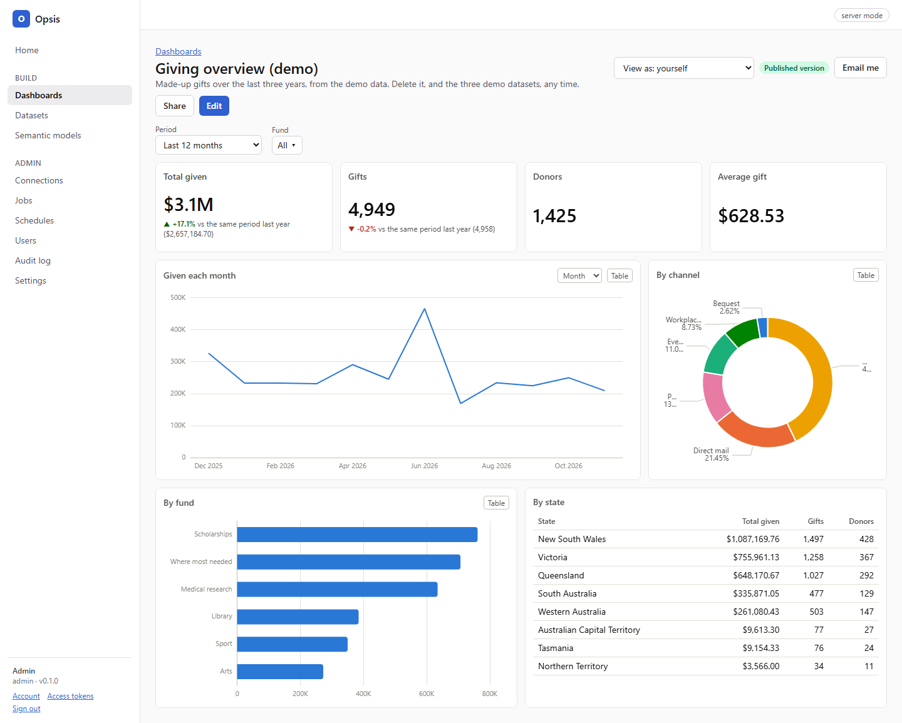

# 1. Getting started

[Guide contents](README.md) | Next: [Connections](02-connections.md)

## What you need

- **Docker**: Docker Desktop on Windows or macOS, Docker Engine on Linux.
- **Git**, to get the code.

## Install on a laptop

In PowerShell (or a terminal on macOS or Linux, using `cp` instead of `copy`):

```powershell
git clone https://github.com/pundip/opsis.git
cd opsis
copy .env.local.example .env
docker compose up -d
```

The first start builds the image and takes a few minutes. Later starts take seconds. When `docker compose ps` shows the api as `healthy`, open http://localhost:8080.

On a laptop there is **no sign-in**: you are the built-in admin, and Opsis only listens on your own machine. The [Windows guide](../../deploy/windows/README.md) covers Docker Desktop memory, Ollama for the assistant, and Claude Desktop.

## Install on a server

A server install has sign-in, a separate worker for background jobs, refresh schedules and backups. Briefly:

```bash
cp .env.server.example .env
# edit .env: set every value marked CHANGE
docker compose run --rm --no-deps api generate-key   # for ENCRYPTION_KEY
docker compose up -d
```

The stack refuses to start while a `CHANGE` value is still a placeholder, and `docker compose logs config-check` says why. The full walk-through (Proxmox LXC, reverse proxy, firewall, Google sign-in, email, backups, an install checklist) is in the [Proxmox guide](../../deploy/proxmox/README.md).

## Laptop and server at a glance

| | Laptop template | Server template |
|---|---|---|
| Sign-in (`AUTH_MODE`) | none | local accounts and Google (`full`) |
| Background jobs | inside the api | a `worker` container |
| Refresh schedules, backups | off (can be turned on) | on |
| Public share links | off | on |
| Email | off | off until a mail server is set |
| Assistant | Ollama, a model on your machine | Claude (needs an API key) |
| MCP (AI clients) | local connections, no token | personal access tokens |

Every setting is in `.env`. After a change run `docker compose up -d` again. The README has the [full list of settings](../../README.md#configuration).

## Signing in

With sign-in on, you see the sign-in page. The first admin is created from `ADMIN_EMAIL` and `ADMIN_INITIAL_PASSWORD` on the first start, and is asked to choose a new password straight away. Other people get an [invitation](07-sharing-and-security.md#people-and-groups). With `AUTH_MODE=full` there is also **Sign in with Google**.

## The screens

The menu on the left:

| Menu | What it does |
|---|---|
| **Home** | The mode, which features are on, and the calendar settings |
| **Dashboards** | Every dashboard you may see; create new ones |
| **Datasets** | The tables Opsis holds; create and refresh them |
| **Semantic models** | One model per dataset |
| **Connections** | Your sources |
| **Jobs** | Background work, such as refreshes, newest first |
| **Schedules** | What runs on its own (when schedules are on) |
| **Users** | People and groups (admins, with sign-in) |
| **Audit log** | Who did what (admins) |
| **Settings** | Backups, the test email, the demo data (admins) |

At the bottom: your name and role, **Account**, **Access tokens** and (with sign-in) **Sign out**. You only see the entries your role and the enabled features allow.

## Roles

| Role | May |
|---|---|
| **viewer** | View published dashboards shared with them |
| **editor** | Everything a viewer may, plus: create datasets from existing connections, edit semantic models, build and publish dashboards |
| **admin** | Everything, including connections, people, groups, settings and the audit log |

On a laptop you are always the admin.

## Demo data

To try everything without connecting a source: **Settings**, **Load demo data**. Or from a terminal:

```powershell
docker compose exec api python -m opsis seed-demo
```

It creates three datasets of made-up giving data, their semantic models (joined to each other) and a published dashboard, **Giving overview (demo)**:

| Dataset | Contents | Joins to |
|---|---|---|
| `demo_gifts` | 15,000 gifts over the last three years | `demo_donors` |
| `demo_donors` | 1,500 donors, each with a tier and a state | `demo_regions` |
| `demo_regions` | The eight states and territories | |



The "By state" table uses a field two joins away (gifts to donors to regions): see [Joining datasets](05-joins.md#two-joins-away).

To remove the demo: delete the dashboard, then the three datasets, then their three connections (named like "Demo gifts (file)").

Next: [Connections](02-connections.md)
