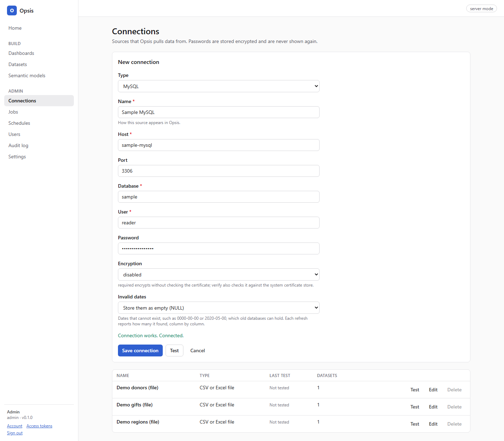

# 2. Connections

[Guide contents](README.md) | Previous: [Getting started](01-getting-started.md) | Next: [Datasets](03-datasets.md)

A connection holds the settings for one source. **Admins** create and change connections; editors create datasets from them.

## Create a connection

1. Open **Connections** and choose **New connection**.
2. Choose the **Type** and give it a **Name** (how it appears in Opsis).
3. Fill in the settings (below for each type).
4. Press **Test**. A green message says the connection works.
5. Press **Save connection**.

Passwords, keys and other secrets are stored encrypted (with `ENCRYPTION_KEY`) and are **never shown again**. When you edit a connection, leave a secret field empty to keep the saved value.

### Invalid dates

Every connection has this setting. It decides what happens to dates that cannot exist, such as MySQL's `0000-00-00`, a zero day or month (`2020-05-00`), or `2021-02-30`:

| Choice | Effect |
|---|---|
| **Store them as empty (NULL)** (default) | The value becomes empty; the dataset page reports how many and shows examples |
| **Read date columns as text, exactly as stored** | All of that connection's date and date-time columns are read as text. You can set one back to a date on the dataset page |
| **Stop the refresh** | The refresh fails and names the table, column, source type and value |

See [Untidy data](03-datasets.md#untidy-data-and-column-types).

## CSV or Excel file

Upload the file in the form (`.csv`, `.tsv`, `.txt`, `.xlsx` or `.xlsm`, up to `MAX_UPLOAD_MB`, 200 MB by default).

| Setting | Notes |
|---|---|
| **File** | The upload |
| **First row is a header** | On by default. Otherwise columns are named `column_1`, `column_2`, ... |
| **CSV delimiter** | `auto`, comma, semicolon, tab or pipe |

- A CSV file is one table. **Each sheet of an Excel workbook is a table.**
- Column types are worked out from the whole file. A column with even one value that is not a number or date is read as text, and the dataset page [suggests a type](03-datasets.md#untidy-data-and-column-types) you can apply.
- File datasets refresh in full only.

**To update the data:** edit the connection, upload the new file (the file name may differ for a CSV; an Excel workbook needs the same sheet names), **Save changes**, then **Refresh now** on each of its datasets.

## PostgreSQL

| Setting | Notes |
|---|---|
| **Host**, **Port** | Port 5432 by default |
| **Database**, **User**, **Password** | Use a user that can only read |
| **SSL mode** | `prefer` (default), `require`, `verify-full` or `disable` |

Tables and **views** of every schema are offered, as `schema.table`. Opsis reads in a read-only session.

## MySQL and MariaDB

| Setting | Notes |
|---|---|
| **Host**, **Port** | Port 3306 by default |
| **Database**, **User**, **Password** | Use a user with `SELECT` only |
| **Encryption** | `disabled` (default), `required` (encrypted, certificate not checked) or `verify` |

Tables and **views** of the one database are offered. Old MyISAM tables, zero dates and unsigned or bit columns are handled.

> **A database on your own computer?** From inside Docker its address is `host.docker.internal`, not `localhost`.

### The sample MySQL database

For practice, a small database (200 donors, 5,000 gifts) ships with Opsis. Add `sample` to the profiles in `.env` (`COMPOSE_PROFILES=sample`), run `docker compose up -d`, and connect with:

| Setting | Value |
|---|---|
| Host | `sample-mysql` |
| Port | `3306` |
| Database | `sample` |
| User | `reader` |
| Password | `reader-sample-pw` |

It is used in the [joins walk-through](05-joins.md#walk-through-gifts-donors-and-a-spreadsheet). Its data is recreated every time it starts.

## Google Sheets

Opsis reads spreadsheets with read-only access. Each tab is a table. Sign in with your own Google account through your own OAuth client (the same `credentials.json` a Python script would use), or with a service account.

### With your Google account

1. In the Google Cloud console, pick or create a project and enable the **Google Sheets API** and the **Google Drive API** (APIs and services, Library). Drive is only used to list your spreadsheets and to show which account is connected.
2. Set up the OAuth consent screen (Google Auth Platform). While its publishing status is **Testing**, add your account as a test user. Google then ends the sign-in after 7 days, so you would reconnect every week. Setting the app **In production** stops that.
3. Create an OAuth client ID of type **Desktop app** (a **Web application** client also works) and download its JSON.
4. In Opsis, a new **Google Sheets** connection: sign in with **My Google account (OAuth)**, load `credentials.json`, save, then choose **Connect** on the connection. Google asks you to allow read-only access.
   - On a laptop at `http://localhost:8080`, Google comes straight back to Opsis.
   - On a server or under a sub-path, Google sends the browser to an address that does not load (it starts with `http://localhost`). Copy the **whole address** from the address bar and paste it into Opsis.
   - Or use an existing `token.json` made with the same client, instead of consenting again.
5. **Pick a spreadsheet** from your list, or paste its URL in the connection settings.

If Google stops accepting the sign-in (access removed, password changed, 7 days passed in Testing), the connection shows **Needs reconnecting**, its scheduled refreshes pause and, with email on, its owner is emailed. Choose **Reconnect**.

### With a service account

In the Google Cloud console: IAM and admin, **Service accounts**, create one with no roles, then **Keys**, **Add key**, **JSON**. Share the spreadsheet with the service account's email (ending `iam.gserviceaccount.com`) as a **Viewer**. In Opsis choose **A service account**, give the key file and the spreadsheet's URL.

Column types come from the cells: numbers, true or false, and cells **formatted as dates or date-times**. Sheets refresh in full only.

## Salesforce

Each object (standard or custom) is a table.

1. In Salesforce Setup, open the **External Client App Manager** and create an app. Enable OAuth with the scope **Manage user data via APIs (api)**, any callback URL (not used), and the **Client Credentials Flow**. In its policies, choose the user it runs as: an integration user with API access who can read the objects you want.
2. Copy the app's **Consumer Key** and **Consumer Secret**.
3. In Opsis, a new **Salesforce** connection: your My Domain URL (Setup, My Domain, for example `https://acme.my.salesforce.com`), sign in with `client_credentials`, the key and the secret. Optionally list the objects to offer, such as `Account, Opportunity, Donation__c`.
4. **Test** shows the organisation's name and edition, so you can check you are connected to the right one.

A username, password and security token also work (`password`). Datasets can use **Merge** refresh: only records changed since the last refresh are read (by `SystemModstamp`) and merged by `Id`.

## Test, edit and delete

- **Test** on a connection's row checks it again; the result stays on the row.
- **Edit** changes settings. The type cannot be changed.
- **Delete** is available once the connection has no datasets.
- A red **Secrets unreadable** badge means `ENCRYPTION_KEY` differs from the one used to save them: restore the old key, or enter the secrets again.

Next: [Datasets](03-datasets.md)
