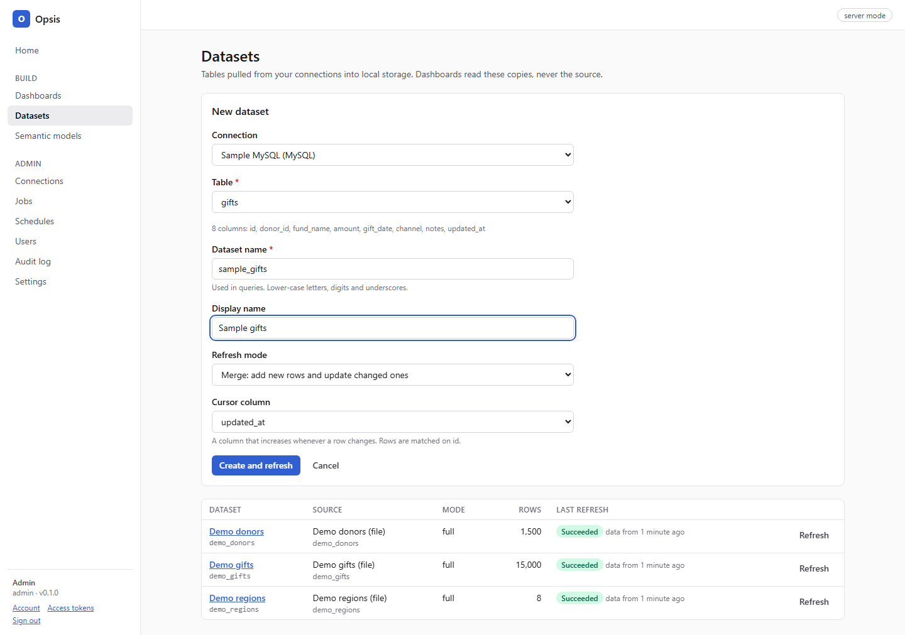
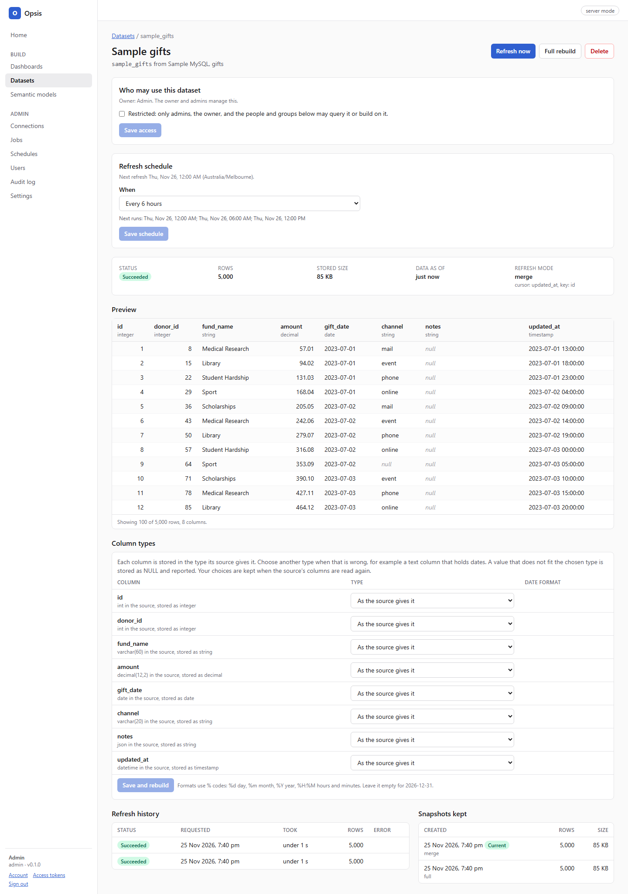
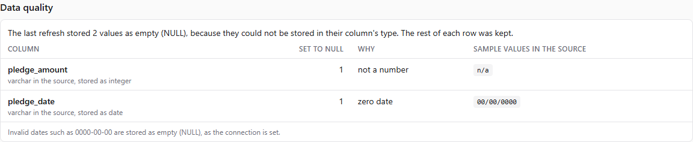
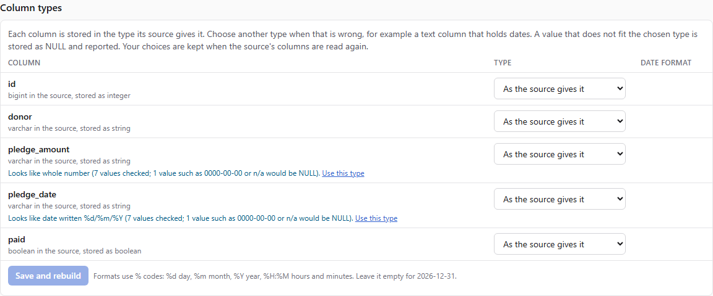

# 3. Datasets

[Guide contents](README.md) | Previous: [Connections](02-connections.md) | Next: [Semantic models](04-semantic-models.md)

A dataset is a copy of **one table** (or view, sheet or Salesforce object), stored by Opsis as Parquet files. Queries and dashboards read the copy, so your source is only touched during a refresh.

> To combine several tables, see [Joining datasets](05-joins.md).

## Create a dataset

1. Open **Datasets** and choose **New dataset**.
2. Pick the **Connection**, then the **Table**.
3. Set the **Dataset name** (used in queries and joins: lower-case letters, digits and underscores, starting with a letter) and the **Display name**.
4. Choose the **Refresh mode** and, for append or merge, the **Cursor column**.
5. Press **Create and refresh**.

All columns of the table are copied. To leave some out (for example sensitive ones), create a view in the source without them and make the dataset from the view.

> **A dataset cannot be edited after it is created.** To change its table or refresh mode, delete it and create it again with the same name (see [Deleting](#deleting-and-recreating)).

## Refresh modes

| Mode | Each refresh | Use it when | Needs |
|---|---|---|---|
| **Full** | Reads everything and replaces the copy | Small or medium tables; rows change or get deleted | Nothing |
| **Append** | Adds rows whose cursor value is higher than the last one seen | Rows are only ever added, such as a log | A cursor column that only increases, such as an id or a created date |
| **Merge** | Reads rows changed since the last cursor value and replaces matching rows | Rows are added and updated | A primary key, and a cursor that increases on every change, such as `updated_at` |

- Cursor columns can be numbers, dates or date-times.
- Append and merge **do not notice deleted rows**. Use **Full rebuild** on the dataset page now and then if rows are deleted in the source.
- Database views have no primary key, so they offer full and append only. Files and Google Sheets offer full only. Salesforce offers full and merge.
- The first refresh, and **Full rebuild**, always read everything.

## The dataset page

- **Refresh now** reads the source again. **Full rebuild** (append and merge only) reloads every row and resets the cursor.
- The top panel shows the status, row count, stored size, how old the data is, and the refresh mode with its cursor and key.
- **Preview** shows the first 100 rows. Row-level security applies to it.
- **Refresh history** lists each refresh, its duration, rows and any error. If a refresh fails, the previous data stays in place and dashboards keep working.
- **Snapshots kept** lists the copies on disk. Opsis keeps the newest 3 (`SNAPSHOT_RETENTION`).

Refreshes run one at a time in the background. **Jobs** lists them all.

## Refresh schedules

With `FEATURE_SCHEDULED_REFRESH=true` (on by default on a server), the dataset page has a **Refresh schedule** card:

- Choose **Off**, a preset (every hour, every 6 hours, every day at 06:00, weekdays at 07:00, Mondays at 07:00, the 1st of each month at 06:00) or **Custom (cron)**.
- A cron expression is minute, hour, day, month, weekday. The shortest interval is **15 minutes**.
- The card shows the **next runs** before you press **Save schedule**.
- Times are in `WORKSPACE_TIMEZONE`.
- A run missed while Opsis was stopped is not made up; the next one runs as usual.

## Untidy data and column types

A value that cannot be stored in its column's type (a zero date, `n/a` in a number column) **never fails a refresh**. It is stored as empty (NULL), and the **Data quality** section of the dataset page shows, for each column, how many values, why, and up to five raw examples.

The same report is kept in the refresh job, shown as a count in the refresh history, and returned to AI agents. Sample values are hidden from people who may not see the data (restricted datasets, row-level security).

Reasons you may see include: zero date, partial date (zero year, month or day), impossible date, not a number, not a whole number, too large, not true or false, not a date.

### Column types

The **Column types** section lets you choose how each column is stored: **Text**, **Whole number**, **Decimal number**, **Date**, **Date and time** or **True or false**. For dates written differently from `2026-12-31`, give a format with `%` codes, for example `%d/%m/%Y` for `31/12/2026`.

For a text column whose values consistently look like dates, numbers or true/false, Opsis shows a **suggestion** with a **Use this type** link. It never applies one by itself, and leaves codes with leading zeros (such as postcodes) as text.

Press **Save and rebuild**: the dataset is refreshed in full with the new types. Your choices are kept when the source's columns change. Values that do not fit the chosen type are reported like any other.

## Restricting who may use a dataset

With sign-in, an admin or the dataset's owner (the person who created it) sees **Who may use this dataset**:

- Tick **Restricted**, choose people and groups, and **Save access**.
- Only admins, the owner and those listed may query it or build on it, including through joins and AI agents.
- A restriction set by an admin can only be lifted by an admin.
- **Dashboards already shared stay viewable** by the people they are shared with (with row-level security applied). The panel lists such dashboards and share links so you can change their sharing.

To limit which **rows** people see, use [row-level security](07-sharing-and-security.md#row-level-security).

## Deleting and recreating

**Delete** on the dataset page removes the dataset, its stored data, its semantic model (all versions), its schedule and its access list. It does not check what uses it:

- Joins to it become errors, and visuals that use its fields show "The query is not valid" until it is back. Other visuals keep working.
- If you create a dataset **with the same name** again, those joins and dashboards work again once it has refreshed.
- Its model starts from scratch. Before deleting, download the model's YAML (**Semantic models**, the dataset, **Download**) and paste it back afterwards.

## When a refresh fails

The error is shown on the dataset page and in **Jobs**. Common ones:

| Message | What to do |
|---|---|
| "Could not connect: ..." | Check the source is up and **Test** the connection |
| "The columns in the source have changed..." | **Full rebuild** (append and merge datasets) |
| "Table ... was not found in the source." | The table was renamed or dropped; recreate the dataset |
| "... holds an invalid date ..." | The connection is set to stop on invalid dates; change [that setting](02-connections.md#invalid-dates) or fix the data |
| "...needs reconnecting" (Google Sheets) | **Reconnect** the Google account on the connection |

Next: [Semantic models](04-semantic-models.md)
