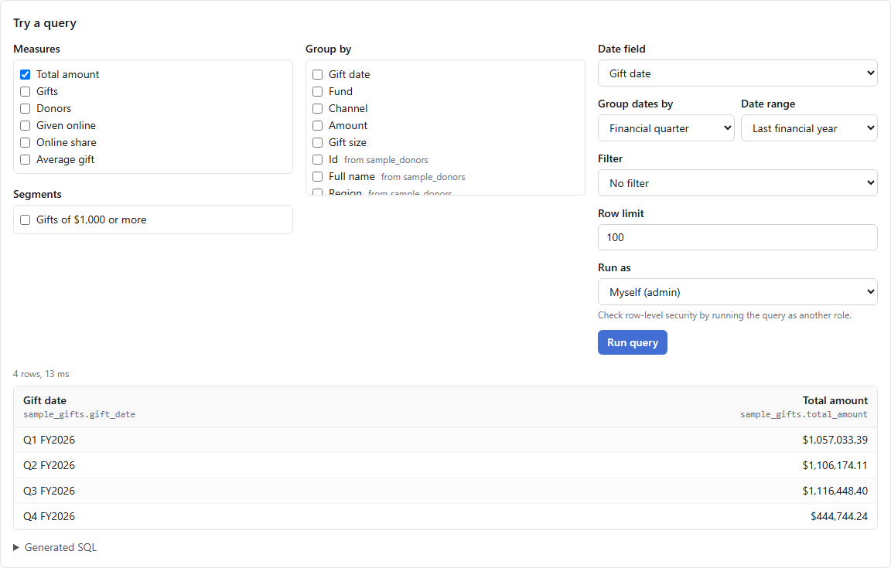

# 4. Semantic models

[Guide contents](README.md) | Previous: [Datasets](03-datasets.md) | Next: [Joining datasets](05-joins.md)

Every dataset has one **semantic model**. It gives fields their names and meaning once, so every dashboard, query and AI agent uses the same definitions:

- **Dimensions**: what you group and filter by (fund, region, gift date).
- **Measures**: numbers worked out over rows (total amount, number of gifts, average gift).
- **Segments**: named filters (large gifts).
- **Joins**: links to other datasets ([chapter 5](05-joins.md)).
- **Row-level security**: who sees which rows ([chapter 7](07-sharing-and-security.md#row-level-security)).

## The generated model

After a dataset's first refresh, Opsis writes a **starter model**: a dimension for every column, a **Rows** count, and a total for every number column that does not look like an id. While you have not edited it, it follows the columns. Once you save your own, Opsis never changes it.

## The model page

Open **Semantic models** and choose a dataset. The page has three parts.

### Try a query

Tick measures and segments, tick fields to **Group by** (fields from joined datasets are marked "from ..."), choose a **Date field** with a grouping and range, add a **Filter**, then **Run query**. The result shows how long it took, and **Generated SQL** shows what ran.



Admins also get **Run as**, to run the query as a viewer or editor with chosen attributes and check row-level security.

### Model definition (YAML)

Edit the text, then:

- **Check** reports every problem with its location, for example `/measures/total_amount/column`.
- **Save model** stores a new version (add a note if you like). It is checked first.
- **Discard changes** returns to the saved text.
- **Regenerate from columns** replaces the text with a fresh starter model; nothing is saved until you press Save.
- **Download** gets the model as a `.yml` file.

> **Comments are not kept.** The model is stored as data and shown back as YAML, so `#` comments and your layout disappear when you save. Keep notes in `description` or the version note, or keep an annotated copy elsewhere.

If someone else saved the model while you were editing, your save is refused; reload the page and make your change again.

### Warnings

Some models save but can give numbers or access you do not expect. Opsis lists these warnings after **Check** and **Save model**, and at the top of the model page for as long as they apply. They never stop a save.

| Warning | What it means | What to do |
|---|---|---|
| A join key is not unique | A dataset this model joins to has a key value on more than one row, so [rows are counted more than once](05-joins.md#repeated-keys) | Make the key unique there, or join on columns that pick out one row |
| Row-level security does not carry over | A joined dataset has security rules and this one has none, so [its rows are not limited](05-joins.md#row-level-security-and-joins) | Add a rule to this model, on one of its own columns |
| A join key could not be checked | The server was busy, or reading the data failed or took too long | Press **Check** again |

AI agents get the same warnings when they read, check or change a model.

### Version history

Every save is a version, with who and when. **Restore** makes an old version the current one (as a new version).

## Writing a model

A complete example for the sample gifts (the [joins walk-through](05-joins.md#walk-through-gifts-donors-and-a-spreadsheet) builds it step by step):

```yaml
dataset: sample_gifts
label: Sample gifts
dimensions:
  gift_date: {column: gift_date, type: time, label: Gift date}
  fund_name: {column: fund_name, type: string, label: Fund}
  channel: {column: channel, type: string, label: Channel}
  amount: {column: amount, type: number, label: Amount}
  gift_size:
    expr: "CASE WHEN amount >= 1000 THEN 'Large' WHEN amount >= 200 THEN 'Medium' ELSE 'Small' END"
    type: string
    label: Gift size
measures:
  total_amount: {agg: sum, column: amount, format: currency_aud, label: Total amount}
  gift_count: {agg: count, label: Gifts}
  donors: {agg: count_distinct, column: donor_id, label: Donors}
  online_amount: {agg: sum, column: amount, filter: "channel = 'online'", format: currency_aud, label: Given online}
  online_share: {expr: "{online_amount} / NULLIF({total_amount}, 0)", format: percent, label: Online share}
  average_gift: {expr: "{total_amount} / NULLIF({gift_count}, 0)", format: currency_aud, label: Average gift}
segments:
  large_gifts: {filter: "amount >= 1000", label: "Gifts of $1,000 or more"}
joins:
  - to: sample_donors
    on: {donor_id: id}
    relationship: many_to_one
  - to: fund_details
    on: {fund_name: fund}
    relationship: many_to_one
```

Field names (`total_amount`) are lower-case letters, digits and underscores. Queries and dashboards refer to a field as `dataset.field`, for example `sample_gifts.total_amount`.

### Dimensions

| Key | Meaning |
|---|---|
| `column` or `expr` | The column, or an expression over this dataset's columns (one of the two) |
| `type` | `string`, `number`, `boolean` or `time` |
| `label`, `description` | Names shown to people and agents |
| `grains` | Time only: which groupings are allowed (default all) |
| `timezone` | Time only: the zone a timestamp **without** an offset was written in, for example `UTC` |

### Measures

An aggregation:

| Key | Meaning |
|---|---|
| `agg` | `sum`, `count`, `count_distinct`, `avg`, `min` or `max` |
| `column` | Required except for `count` (which then counts rows) |
| `filter` | Count only matching rows, for example `channel = 'online'`. A segment can be used by name: `"{large_gifts} AND channel = 'online'"` |

or a formula over other measures: `expr: "{total_amount} / NULLIF({gift_count}, 0)"` (use `NULLIF` to avoid dividing by zero). A formula cannot use columns directly.

`format` controls display: `currency_aud` (or `currency_` and any currency code), `percent` (0.25 shows as 25%), or nothing for a plain number.

### Segments

`name: {filter: "...", label: "..."}`. Tick them in **Try a query**, or use them inside a measure's `filter`.

### What expressions may contain

Dimension expressions, segment and measure filters, and security rules are checked against an allow-list:

- **Allowed:** column names of this dataset (no table prefix), text and numbers, `+ - * / %`, `||` (join text), comparisons, `AND OR NOT`, `IS`, `IN`, `BETWEEN`, `LIKE`, `ILIKE`, `CASE`, `CAST` to text, whole or decimal numbers, boolean, date or timestamp, and these functions: `lower upper trim length substring left right replace concat contains starts_with ends_with abs round floor ceil sign sqrt power ln log greatest least coalesce nullif year quarter month day day_of_week date_trunc datediff strftime`.
- **Not allowed:** sub-queries, other tables, aggregates inside a dimension (define a measure), window functions, and any other function.

The query engine is DuckDB, so functions behave as they do there. `day_of_week` is 0 for Sunday.

The full format is [spec/semantic-model.schema.json](../../spec/semantic-model.schema.json).

## Dates and calendars

A `time` dimension can be grouped by **day, week, month, quarter, year, financial period, financial quarter** or **financial year**. The calendar comes from `.env`:

| Setting | Default | Meaning |
|---|---|---|
| `WORKSPACE_TIMEZONE` | `Australia/Melbourne` | Decides "today" and the day a timestamp falls on |
| `WEEK_START` | `monday` | Start of a week |
| `FISCAL_YEAR_START_MONTH` | `7` | First month of the financial year |
| `FISCAL_YEAR_LABEL` | `fy_end_year` | "FY2027" or `year_span` for "2026-27" |

Timestamps that carry an offset in the source are converted to the workspace timezone. A timestamp without one is taken as local time, unless the dimension names its zone with `timezone`.

Date ranges can be relative: the screens offer this month, last month, last 30 days, last 12 months, this or last calendar year, this or last financial year, financial year to date and this or last financial quarter. The [JSON](06-dashboards.md#the-json-tab) accepts more, such as `today`, `last_6_months`, `year_to_date` or `last_2_fiscal_years`.

## Moving models around

On **Semantic models**:

- **Export all** downloads a zip of `models/<dataset>.yml`, one per dataset, handy for version control.
- **Import** takes such a zip, or `.yml` files. Every file is checked first and shown with what will change; nothing is saved unless **all** are valid. Each changed model gets a new version.

Next: [Joining datasets](05-joins.md)
