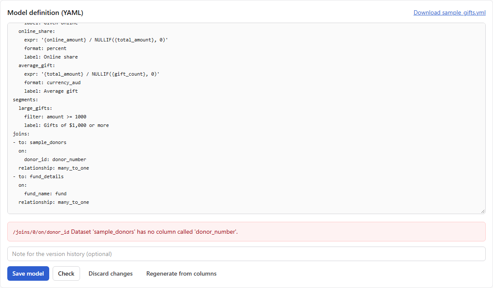
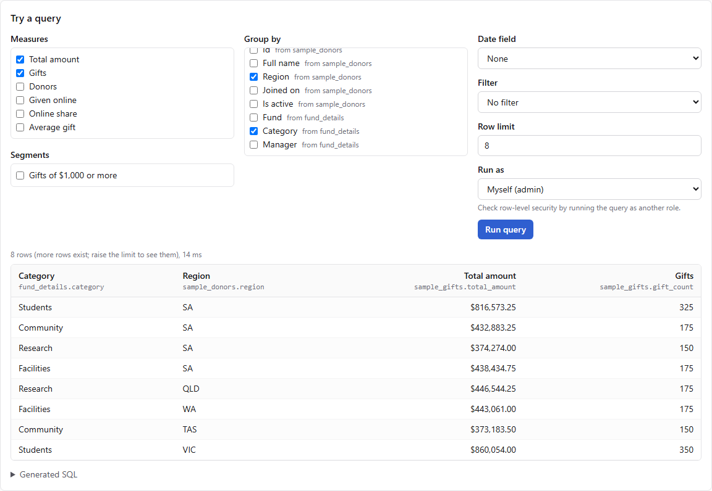

# 5. Joining datasets

[Guide contents](README.md) | Previous: [Semantic models](04-semantic-models.md) | Next: [Dashboards](06-dashboards.md)

A dataset is one table. There are two ways to work with fields from several tables:

| | **A join in the semantic model** | **A view in the source database** |
|---|---|---|
| Where | The base dataset's model (YAML) | SQL in your database |
| Across different sources | Yes (for example MySQL joined to a spreadsheet) | No, one database |
| Good for | Looking up details: donor for a gift, category for a fund | One-to-many, totals before joining, filtering rows, unions, hiding columns |
| Measures | From the base dataset only | Anything the view provides, in one dataset |
| Needs | A matching key on both sides | Permission to create a view |

Use a model join where you can: each table is copied once and any dashboard can use it.

## How a model join works

A join is written in the model of the dataset you **query from** (the base). It adds the other dataset's **dimensions and segments** to the base dataset's fields.

```yaml
joins:
  - to: sample_donors          # the other dataset
    on: {donor_id: id}         # this dataset's column: the other dataset's column
    relationship: many_to_one  # many rows here, one row there
    type: left                 # left (default) or inner
```

- **Measures always come from the base dataset.** To total a donor-level number, query from `sample_donors` instead.
- **`type: left`** keeps every base row; rows with no match show empty joined fields. **`inner`** drops base rows with no match, in queries that use the joined fields.
- A join is only part of a query when that query uses a field from it.
- Several columns can form the key: `on: {region: region, year: year}` (up to 8).

> **Make sure the other side is unique.** Opsis trusts the `relationship` you write. If `fund_details` had two rows for "Library", every Library gift would be counted twice: totals and counts would double. Opsis [warns you](#repeated-keys) but does not stop the save or the query, so each key value must appear once in the dataset you join to.

> **Match the types.** Joining a number column to a text column saves, but queries fail with "Conversion Error: Could not convert string ...". Set the types on the datasets' [column types](03-datasets.md#column-types) so both sides match. Text keys also have to match exactly, including capitals and spaces.

## Walk-through: gifts, donors and a spreadsheet

This joins two MySQL tables and a CSV file, then charts giving by fund category and donor region.

### 1. Make the sources

Set up the [sample MySQL database](02-connections.md#the-sample-mysql-database) connection. Save this as `fund_details.csv`:

```csv
fund,category,manager
Scholarships,Students,Priya Shah
Student Hardship,Students,Priya Shah
Medical Research,Research,Tom Becker
Library,Facilities,Ana Ruiz
Sport,Community,Ana Ruiz
```

Add it as a **CSV or Excel file** connection named "Fund details".

### 2. Create three datasets

In **Datasets**, **New dataset**:

| Connection | Table | Dataset name | Refresh mode |
|---|---|---|---|
| Sample MySQL | `gifts` | `sample_gifts` | Merge, cursor `updated_at` |
| Sample MySQL | `donors` | `sample_donors` | Full |
| Fund details | `fund_details` | `fund_details` | Full |

Wait for each to show **Succeeded**.

### 3. Write the joins

Open **Semantic models**, **sample_gifts**. Replace the definition with the [complete example](04-semantic-models.md#writing-a-model), which ends with:

```yaml
joins:
  - to: sample_donors
    on: {donor_id: id}
    relationship: many_to_one
  - to: fund_details
    on: {fund_name: fund}
    relationship: many_to_one
```

Press **Check**. Mistakes are listed with where they are:



Fix anything listed, then **Save model**. (Opsis may rewrite the layout of your YAML; the meaning is the same.)

### 4. Query across the joins

In **Try a query**, tick **Total amount** and **Gifts**, group by **Category** (from `fund_details`) and **Region** (from `sample_donors`), and **Run query**:



**Generated SQL** shows the `LEFT JOIN`s Opsis wrote.

### 5. Use them on a dashboard

In a visual whose **Dataset** is `sample_gifts`, the joined fields appear with the dataset name, such as **Category (fund_details)** and **Region (sample_donors)**. Use them like any other dimension, and in dashboard filters. [Chapter 6](06-dashboards.md#a-worked-example) builds the dashboard.

## Two joins away

A query can also reach a dataset **two joins away**, through a dataset it joins to. In the demo data, `demo_gifts` joins to `demo_donors`, and `demo_donors` joins to `demo_regions`, so `demo_gifts` can group by `demo_regions.state` with no join of its own:

```yaml
# in demo_donors
joins:
  - to: demo_regions
    on: {state_code: code}
    relationship: many_to_one
```

Rules:

- Two hops at most.
- Every join on the way must be `many_to_one` or `one_to_one`.
- The path never goes **through** a restricted dataset.
- If two paths lead to the same dataset, add a direct join from the base dataset to say which one.
- After a left join, the next join is treated as left too, so base rows are never lost on the way.

## Relationships

| `relationship` | Meaning | Usable in queries |
|---|---|---|
| `many_to_one` (default) | Many base rows point to one row there (gift to donor) | Yes |
| `one_to_one` | One to one | Yes |
| `one_to_many` | One base row has many rows there (donor to gifts) | **No**: it would count the base measures several times |

For "gifts per donor", query from the gifts dataset (grouped by donor). For measures that need the one-to-many direction, such as "donors with their total giving, including donors who gave nothing", use a database view.

## Repeated keys

Opsis checks every `many_to_one` and `one_to_one` join that queries can use, [two joins away](#two-joins-away) included, against the joined dataset's current data. When a key value is on more than one row, the model page shows a warning that names the key, says how many values repeat, and gives up to five of them. For example, with Library listed twice:

> The join to 'fund_details' is declared many_to_one, but its key 'fund' is not unique in 'fund_details': 1 value is on more than one row, for example 'Library' (2 rows). A row of 'sample_gifts' that matches a repeated value is counted once for every row that holds it, so totals and counts are too high in queries that use fields from 'fund_details'.

- **It is a warning, not an error.** The model saves and queries run, with the numbers too high, until the data or the join is fixed.
- **It follows the data.** After the joined dataset refreshes, the next look at the base dataset's model checks the new data. Dashboards do not show the warning, so look at the model after a lookup changes.
- Rows with an empty key are ignored, because they never match.
- The example values are hidden from people who may not see all of that dataset (it is restricted to others, or row-level security applies to them). The count is still shown.

To fix it, remove the duplicates at the source (or make a view with one row per key), or add columns to `on:` until each combination appears once.

## Database views

If the data comes from one database, a view can do joins Opsis does not, including filtering and totals:

```sql
CREATE VIEW gift_details AS
SELECT g.id, g.gift_date, g.fund_name, g.amount, d.full_name, d.region
FROM gifts g
JOIN donors d ON d.id = g.donor_id;
```

The view appears in **New dataset** next to the tables. Grant your read-only user `SELECT` on it. Views have no primary key, so they refresh in full or append.

## Row-level security and joins

A security rule protects the dataset it is written on, **not datasets that join to it**:

- A rule on `sample_donors` (for example `region IN {{ user.attributes.regions }}`) hides donors from the viewer. A query on `sample_gifts` that groups by donor region still counts **all** gifts; the hidden donors' gifts appear with an empty region.
- A query on `sample_gifts` that uses no donor field is not affected at all, even with `type: inner`.

**To limit which gifts someone sees, put the rule on `sample_gifts`** (on one of its own columns), or build a view that includes the column and write the rule on that dataset. Test it with **Run as** on the model page.

When a model with no rules of its own joins to a dataset that has them (directly or two joins away), Opsis [warns](04-semantic-models.md#warnings) on that model. The warning goes once the model has a rule of its own; it does not check that the rule hides the right rows.

## Changing or removing joined datasets

- Deleting a dataset turns joins to it into errors ("There is no dataset called ..."). Visuals that use its fields show "The query is not valid" until it exists again under the same name.
- Renaming a source column breaks joins on it: **Check** the model after changing a source.

## Error messages

| Message | Fix |
|---|---|
| "There is no dataset called 'x'." | Check the `to:` name (the dataset name, not its display name) |
| "Dataset 'x' has no column called 'y'." | In `on:`, the right-hand side must be a column of the other dataset |
| "There is already a join to 'x'." | Only one join per dataset |
| "'x.field' is in dataset 'x', which 'base' has no join to..." | Add a join in the base dataset's model |
| "The join from 'a' to 'b' is one_to_many, which would double-count measures..." | Query from the other dataset, or use a view |
| "'x' can be reached from 'base' through 'a' and through 'b'..." | Add a direct join from the base dataset |
| "... two joins away, through 'a', which is a restricted dataset..." | Add a direct join from the base dataset |
| "Measures must come from the query's own dataset..." | Pick measures of the base dataset |
| "Conversion Error: Could not convert string ..." | The two join columns have different types |

Next: [Dashboards](06-dashboards.md)
