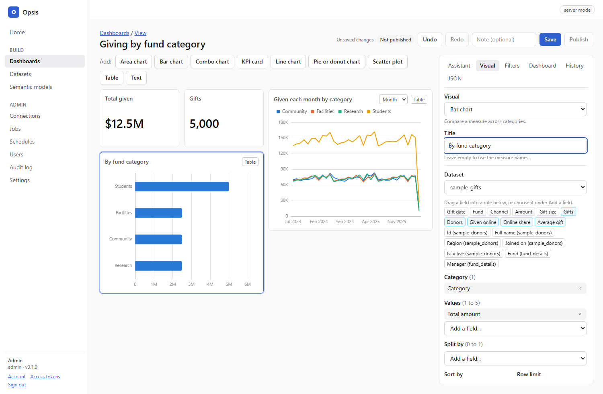
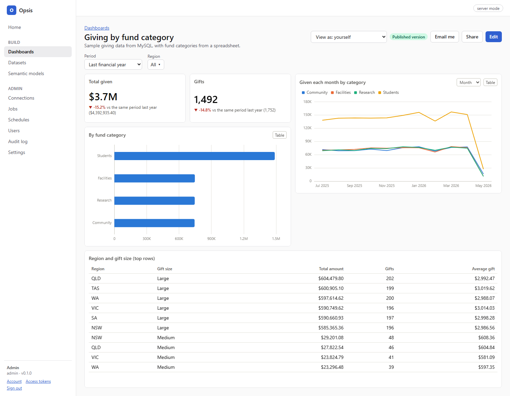
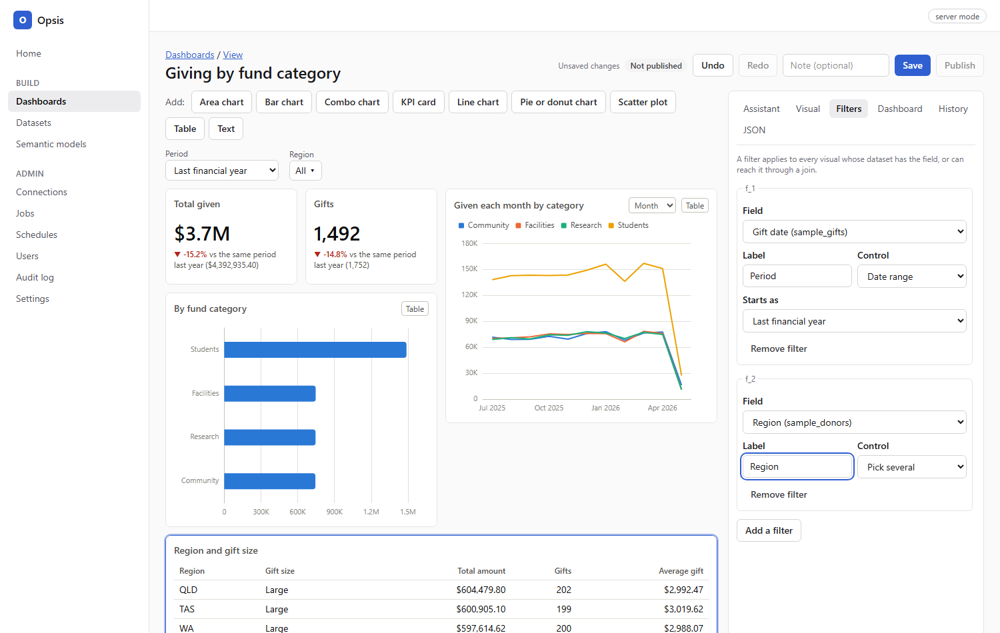
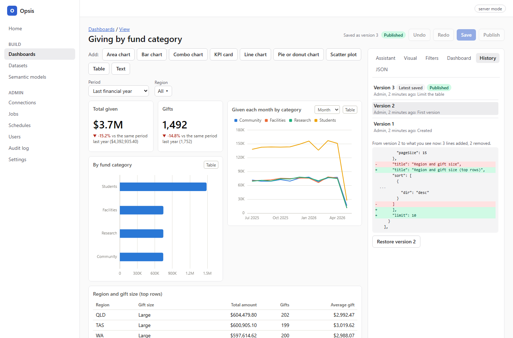
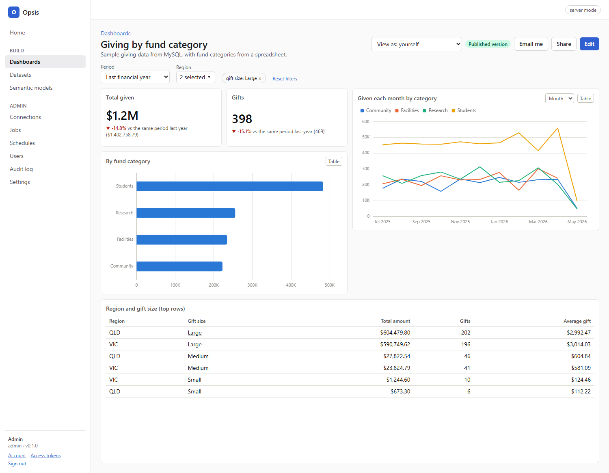

# 6. Dashboards

[Guide contents](README.md) | Previous: [Joining datasets](05-joins.md) | Next: [Sharing and security](07-sharing-and-security.md)

A dashboard is a grid of **visuals** with optional **filters**. Each visual takes its data from one dataset's semantic model (including joined fields). Every save is a new **version**; **publishing** makes a version the one viewers see.

## Create a dashboard

Open **Dashboards**, type a name, and choose **New dashboard**. You are in the editor.

## The editor



- **Add** buttons (top) put a new visual on the grid, next to the last one or on a new row.
- On the **grid**, drag a visual to move it and pull its corner to resize it. Click it (or press Enter) to select it.
- The **side panel** has six tabs: **Assistant** ([chapter 8](08-agents.md)), **Visual**, **Filters**, **Dashboard**, **History** and **JSON**.
- The **top bar** shows whether there are unsaved changes and which version is published, with **Undo** (Ctrl+Z), **Redo** (Ctrl+Y), an optional version note, **Save** and **Publish**.

The grid shows live data as you edit.

## A worked example

This builds the dashboard shown below from the [joins walk-through](05-joins.md#walk-through-gifts-donors-and-a-spreadsheet). With the demo data you can do the same on `demo_gifts`.

1. **Dashboards**, name it "Giving by fund category", **New dashboard**.
2. **KPI card**: Dataset `sample_gifts`, **Value** = Total amount, title "Total given", **Compare with** = `previous_year`.
3. **KPI card**: **Value** = Gifts, same comparison.
4. **Line chart**: **X axis** = Gift date (grouped by month), **Values** = Total amount, **Split by** = Category (fund_details).
5. **Bar chart**: **Category** = Category (fund_details), **Values** = Total amount, **Sort by** "Total amount, high to low", **Orientation** horizontal.
6. **Table**: **Columns** = Region (sample_donors), Gift size, Total amount, Gifts, Average gift. Sort by total, high to low.
7. **Filters** tab: add **Gift date** (label "Period", starts as **Last financial year**) and **Region (sample_donors)** (label "Region", **Pick several**).
8. **Dashboard** tab: add a description and tick **Clicking a value in one visual filters the others**.
9. **Save**, then **Publish**.



## Setting up a visual

Select a visual and use the **Visual** tab:

| Field | What it does |
|---|---|
| **Visual** | Change the type; fields that still have a place are kept |
| **Title** | Leave empty to use the measure names |
| **Dataset** | Where the data comes from. Changing it clears the fields |
| Field roles | Drag a field from the list into a role (or between roles), or choose it under **Add a field...**; **×** removes it. A role only accepts fields that fit |
| Date grouping | On charts a date starts grouped by month; choose another grouping beside the field |
| **Sort by**, **Row limit** | Order and how many rows (up to 10,000; 1,000 if empty) |
| **Options** | Settings of that visual (below) |
| **Remove this visual** | Deletes it (Undo brings it back) |

Measures offered are those of the chosen dataset; dimensions include joined ones, marked with their dataset.

## The visuals

| Visual | Fields | Options | Use it for |
|---|---|---|---|
| **KPI card** | Value (1 measure) | **Compare with**: `none`, `previous_period`, `previous_year`; **An increase is good**; **Shorten large numbers** | Headline numbers. A comparison needs a date range filter on the dashboard |
| **Bar chart** | Category (1), Values (1 to 5 measures), Split by (0 to 1) | **Orientation** vertical or horizontal; **Stacked**; **Show value labels** | Comparing categories. Horizontal suits long names |
| **Line chart** | X axis (1), Values (1 to 5), Split by (0 to 1) | **Smooth lines**; **Show point markers** | Trends over time |
| **Area chart** | X axis (1), Values (1 to 5), Split by (0 to 1) | **Stacked** (on by default); **Smooth lines** | Volume over time, parts of a total |
| **Combo chart** | Category (1), Bars (1 to 3), Lines (1 to 3) | **Stack the bars**; **Smooth lines** | Two kinds of measure; give a count its own **Right axis** next to amounts |
| **Pie or donut** | Slices (1), Value (1) | **Donut**; **Largest slices to show** (2 to 8, rest in "Other") | A few parts of a whole |
| **Scatter plot** | One point per (1), X axis (1 measure), Y axis (1 measure), Colour by (0 to 1) | **Point size** | The relationship between two measures. Set a row limit |
| **Table** | Columns (1 to 30, dimensions and measures) | **Rows per page** (default 15); **Conditional formatting** | Exact values |
| **Text** | none | Markdown | Headings and notes |

For **conditional formatting** on a table, add a rule: the column's full name (such as `sample_gifts.total_amount`), `gt`, `gte`, `lt`, `lte` or `eq`, a number, and a style (`good`, `bad` or `highlight`). The styles carry a symbol as well as a colour.

## Filters



On the **Filters** tab, **Add a filter**, then choose:

- **Field**: any dimension of the datasets the dashboard uses, including joined ones.
- **Label**.
- **Control**: **Pick several**, **Pick one** or **Search text**; date fields are always a **Date range**, with **Starts as** for its initial value.

A filter applies to **every visual whose dataset has the field, or can reach it through a join**. To limit it to some visuals, set its `targets` in the [JSON](#the-json-tab).

## Dashboard settings

The **Dashboard** tab sets the **title**, **description**, **colour mode** (auto follows each viewer's system, light or dark) and whether clicking a value filters the other visuals.

## Saving, publishing and history

- **Save** creates a new version, with your note.
- **Publish** makes the latest saved version the one viewers see. Until you publish again, viewers keep the previous published version.
- If someone else saved while you were editing, your save is refused; **Reload the latest version** (your unsaved changes are lost, so note them first).
- **Leaving the editor** with unsaved changes asks first. After a click on the menu or a link, or the Back button, choose **Stay** or **Leave without saving**. Closing or reloading the tab shows the browser's own warning.
- When someone else, or an AI agent, saves a version while the editor is open, a banner appears with **Undo** (or **Load version** if you have unsaved changes).

The **History** tab lists every version, marks the latest and the published one, shows what changed between a version and what you see, and **restores** it (as a new version).



## The JSON tab

The whole dashboard as text, following [spec/dashboard.schema.json](../../spec/dashboard.schema.json). Edit it and **Apply**: it is checked first, problems are listed with their location, and nothing changes if it is not valid. Apply changes only the editor; **Save** as usual.

Some things can only be set here:

```json
"layout": { "columns": 12, "rowHeight": 40 },
"theme": { "mode": "auto", "palette": ["#1f77b4", "#ff7f0e", "#2ca02c"] },
"filters": [
  { "id": "f_region", "type": "multiSelect", "field": "sample_donors.region",
    "label": "Region", "default": ["VIC"], "targets": ["v_4"] },
  { "id": "f_period", "type": "dateRange", "field": "sample_gifts.gift_date",
    "default": { "relative": "last_6_months" } }
]
```

and, on an item, filters and segments that apply to that visual only:

```json
{
  "id": "v_4",
  "visual": "bar",
  "position": { "x": 0, "y": 3, "w": 6, "h": 7 },
  "dataset": "sample_gifts",
  "bindings": { "category": ["fund_details.category"], "value": ["sample_gifts.total_amount"] },
  "filters": [{ "field": "sample_gifts.channel", "op": "eq", "values": ["online"] }],
  "segments": ["sample_gifts.large_gifts"]
}
```

Filter operators: `eq`, `neq`, `in`, `not_in`, `gt`, `gte`, `lt`, `lte`, `between`, `contains`, `starts_with`, `ends_with`, `is_null`, `is_not_null`, `in_range` (see [the query format](../../spec/semantic-query.schema.json)). Give such a visual a title that says it is filtered.

## Viewing a dashboard



- **Filters** across the top: choose values; date ranges also offer **Custom range** with from and to dates.
- **Click a bar, slice or table value** (bar, combo, pie and table visuals) to filter the others. The selection shows as a chip: click it to remove it. **Reset filters** clears everything.
- The **dropdown on a time chart** switches its grouping between year, quarter, month, week and day (or the financial periods, if the chart uses them).
- **Table** / **Chart** shows any chart's data as a table. Click a table's column header to sort.
- The address bar keeps your filters, so a view can be **bookmarked or sent**.
- **RLS bypassed** on a visual means security rules exist on its data but do not apply to your role: you see every row.
- Editors see the draft and can switch to **Show the published version**. Viewers see only the published version.

Toolbar buttons (depending on your role and the features): **View as** (admins), **Email me**, **Share**, **Edit**.

## The dashboard list

**Dashboards** shows each dashboard as **Draft**, **Published**, or published with **Unpublished changes**. The owner and admins can **Edit** or **Delete** (deleting removes all versions).

## When a visual shows a problem

| Message | Likely cause |
|---|---|
| "Choose fields for this visual..." | A required role is empty |
| "No data for the current filters." | The filters exclude everything |
| "The query is not valid." | A field no longer exists, or a join was removed: check the dataset's model |
| "...no join to..." | Add a [join](05-joins.md), or choose fields from one dataset |

Next: [Sharing and security](07-sharing-and-security.md)
