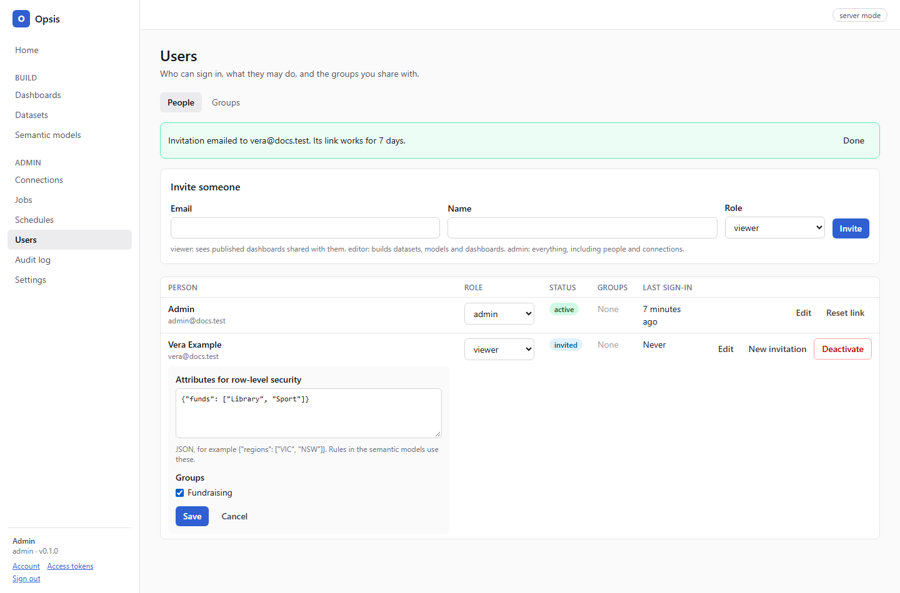
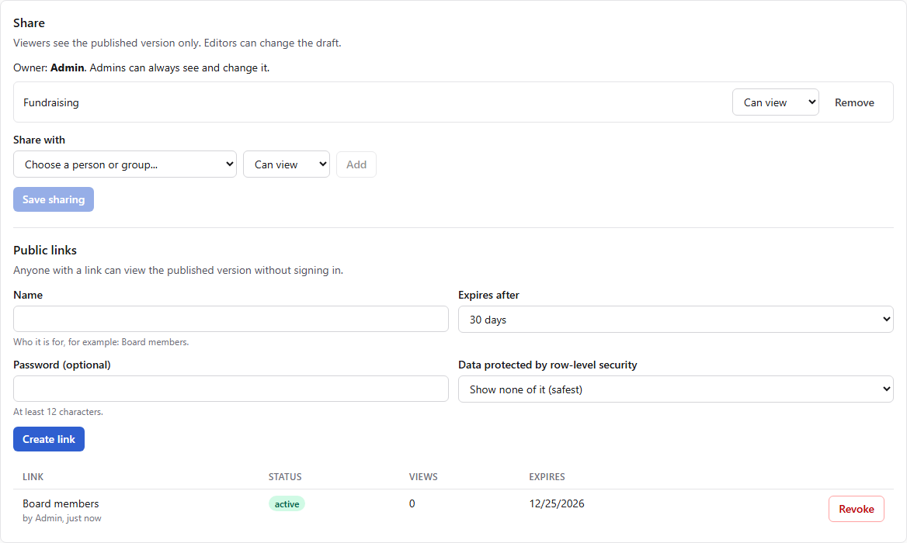
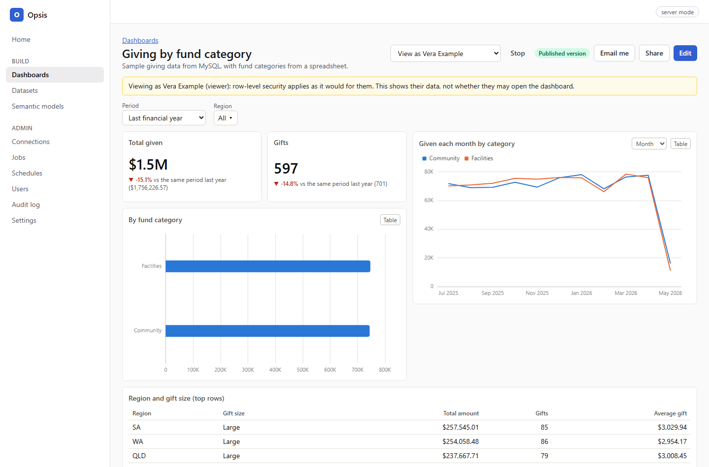

# 7. Sharing and security

[Guide contents](README.md) | Previous: [Dashboards](06-dashboards.md) | Next: [AI agents and the assistant](08-agents.md)

People, groups and sharing need sign-in (`AUTH_MODE=local` or `full`); on a laptop with `AUTH_MODE=none` there is only you. You can still write and test [row-level security](#row-level-security) there, and the audit log works.

## Sign-in modes

| `AUTH_MODE` | How people sign in |
|---|---|
| `none` | No sign-in; one built-in admin; only on your own machine |
| `local` | Email and password |
| `full` | Email and password, or **Sign in with Google** (see the [Proxmox guide](../../deploy/proxmox/README.md) for the Google set-up) |

Passwords need at least 12 characters. After 5 failed attempts for an address within 15 minutes, sign-in for it pauses, for longer each time up to an hour. Sessions end after 12 hours without use, and after 14 days in any case (`SESSION_IDLE_HOURS`, `SESSION_MAX_DAYS`).

## People and groups

Admins manage people on **Users**.

- **Invite someone:** email, name and role. The invitation is a one-time link valid for **7 days**. With email on it is sent; otherwise (or if sending fails) the link is shown once for you to pass on. With Google sign-in, an invited person can simply sign in with Google.
- **Edit** a person to set their **attributes** (JSON used by row-level security) and **groups**.
- Change a **role** in the list; **Deactivate** or **Reactivate** an account.
- **New invitation** or **Reset link** (a password reset valid for 24 hours).
- The **Groups** tab creates groups, for sharing with several people at once.



With email on, the sign-in page has **Forgotten your password?**. If no admin can sign in, run `docker compose exec api python -m opsis reset-link <email>` on the server.

**Account** (bottom left) lets each person change their password, see their emailed dashboards, and **Sign out everywhere**.

## Roles

| | viewer | editor | admin |
|---|---|---|---|
| View published dashboards shared with them | yes | yes | yes (all) |
| Create datasets from existing connections, edit models | | yes | yes |
| Create dashboards; edit and publish their own or those shared to edit | | yes | yes |
| Share a dashboard, create share links, delete it | | its owner | yes |
| Connections, people, settings, audit log | | | yes |

## Sharing a dashboard

On the dashboard, **Share** (shown to its owner and admins):

1. Under **Share with**, choose a person, a group or **Everyone in the workspace**.
2. Choose **Can view** or **Can edit**, then **Add**.
3. **Save sharing**.



- **Can view** shows the **published** version only, so publish first.
- **Can edit** lets an editor change and publish the draft. A viewer-role person shared as an editor can still only view.
- A person sees the data through the dashboard even if they cannot use its datasets directly. [Row-level security](#row-level-security) still applies to them.
- If the dashboard uses a [restricted dataset](03-datasets.md#restricting-who-may-use-a-dataset), only that dataset's owner or an admin can share it with people outside its list. The panel says so.

## Public share links

With `FEATURE_PUBLIC_SHARE_LINKS=true` (server default), the same panel offers links that need **no sign-in**:

| Setting | Notes |
|---|---|
| **Name** | Who it is for |
| **Expires after** | Never, 1, 7, 30 (default) or 90 days |
| **Password (optional)** | At least 12 characters |
| **Data protected by row-level security** | **Show none of it** (default and safest), **Show what I can see**, or chosen attributes (admins) |

The link is shown **once**; copy it then. The list shows each link's status, views and expiry, with **Revoke**. A link shows the published version, read-only, with its filters. Anyone who has the link can use it, so set an expiry.

## Row-level security

Rules in a [semantic model](04-semantic-models.md) filter which rows each person sees, everywhere: dashboards, queries, previews, emails, agents and share links.

```yaml
rls:
  - filter: "fund_name IN {{ user.attributes.funds }}"
  - filter: "owner_email = {{ user.email }}"
    applies_to_roles: [viewer]
```

- The filter is an expression over **this dataset's columns**. It can use `{{ user.attributes.<name> }}`, `{{ user.email }}` and `{{ user.role }}`.
- `applies_to_roles` defaults to `viewer` and `editor`. Admins are exempt unless you list `admin`.
- All rules that apply are combined with AND.
- A rule whose attribute is missing or empty **shows no rows**. Give the person an attribute such as `{"funds": ["Library", "Sport"]}`.
- When a rule exists but does not apply to you, visuals show **RLS bypassed**.
- Share links never get an exemption.

> **Put the rule on the dataset whose rows must be hidden.** A rule on a joined dataset does not remove rows from the dataset that joins to it. See [Row-level security and joins](05-joins.md#row-level-security-and-joins).

### Test it before you rely on it

- On the model page, **Try a query** with **Run as** a viewer and the attributes you want to check.
- On a dashboard, admins choose **View as** a person, or "a viewer with attributes". It shows their data (not whether they may open the dashboard).



## Audit log

**Audit log** (admins) records sign-ins, people and group changes, sharing, links, publishing, model, dataset and connection changes, and every change made by an AI agent. Filter by **Kind** or **Person**. Entries are never changed or removed. It works on a laptop too.

## Secrets

- Connection passwords and keys are encrypted with `ENCRYPTION_KEY`. Keep that key safe: **backups do not include it**, and without it saved passwords cannot be read.
- Keep `.env` out of version control.

Next: [AI agents and the assistant](08-agents.md)
