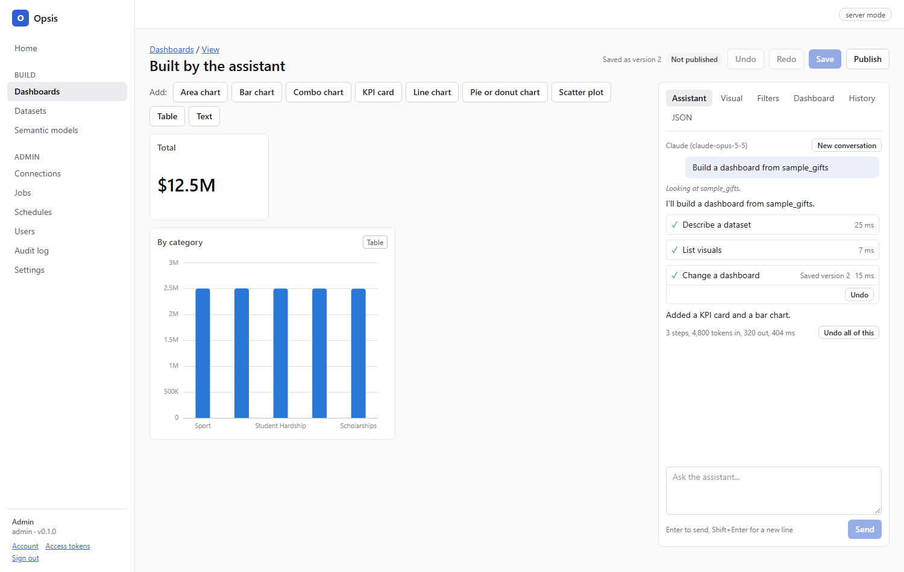
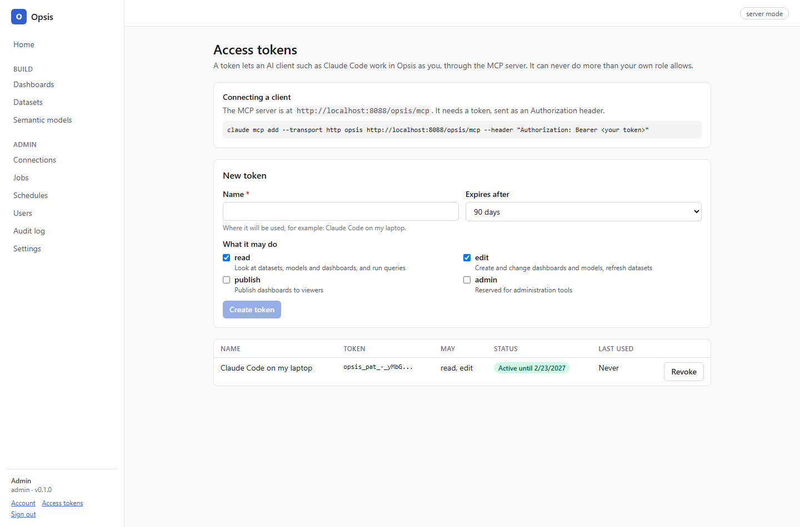

# 8. AI agents and the assistant

[Guide contents](README.md) | Previous: [Sharing and security](07-sharing-and-security.md) | Next: [Running Opsis](09-operations.md)

AI agents work on the same dashboards and models as you, with your access. Every change they make is a normal version, marked as the assistant's, that you can undo. There is no raw SQL: agents query through semantic models.

## The assistant in the editor

The editor's **Assistant** tab (with `FEATURE_ASSISTANT=true`) can answer questions about the data and change the dashboard you have open.



- **Select a visual** and "this" means that visual.
- **Save your own changes first**; Send waits until you have.
- Each tool call is a step you can open to see what it sent and got back. **Undo** reverses one change, **Undo all of this** reverses the whole request.
- It can also add or change measures in a semantic model and start refreshes.
- It **cannot** create, publish or share dashboards: use the editor's buttons.
- Enter sends, Shift+Enter starts a new line, **New conversation** starts afresh.
- Each request has a budget (25 tool calls, 100,000 output tokens, 10 minutes by default). When one runs out it stops and says so; ask it to continue.

Examples: "Add a line chart of total amount by month, split by category", "Make this a horizontal bar chart of the top 10", "Which region grew most this financial year?"

### Choosing the model

| Provider | Set in `.env` | Notes |
|---|---|---|
| **Ollama** (laptop default) | `ASSISTANT_PROVIDER=ollama`, `OLLAMA_MODEL` (default `gemma4:12b`), `OLLAMA_URL` | Runs on your machine. Install Ollama and `ollama pull gemma4:12b`. Slower and less reliable: a small dashboard can take a few minutes |
| **Claude** (server default) | `ASSISTANT_PROVIDER=anthropic`, `ANTHROPIC_API_KEY`, optional `ANTHROPIC_MODEL`, `ANTHROPIC_EFFORT` | Needs an API key. Declined requests are re-run on a recommended model (`ANTHROPIC_FALLBACKS`) |

Budgets: `ASSISTANT_MAX_STEPS`, `ASSISTANT_MAX_OUTPUT_TOKENS`, `ASSISTANT_TIMEOUT_SECONDS`, `ASSISTANT_MAX_ROWS` (rows of a result shown to the model).

## MCP: Claude Code, Claude Desktop and other agents

Opsis has an MCP server at `<your address>/mcp`, for example `http://localhost:8080/mcp`.

### On a laptop

No token is needed. Claude Code started in the `opsis` folder finds the server through the repository's `.mcp.json`. From anywhere else:

```powershell
claude mcp add --transport http opsis http://localhost:8080/mcp
```

For Claude Desktop, add this to `claude_desktop_config.json` (on Windows, `%AppData%\Claude\`):

```json
{
  "mcpServers": {
    "opsis": { "command": "npx", "args": ["-y", "mcp-remote", "http://localhost:8080/mcp"] }
  }
}
```

### On a server: access tokens

With `MCP_AUTH=token` each client needs a personal token. Open **Access tokens** (bottom left), name it, choose how long it lasts (7 days to a year) and what it may do:

| Scope | Allows |
|---|---|
| `read` | Look at datasets, models and dashboards; run queries |
| `edit` | Create and change dashboards and models; refresh datasets |
| `publish` | Publish dashboards (and share them) |
| `admin` | Reserved |



The token is shown **once**. It never allows more than your role, expires, and can be revoked.

```bash
claude mcp add --transport http opsis https://your-domain/opsis/mcp --header "Authorization: Bearer <your token>"
```

Claude Desktop:

```json
{
  "mcpServers": {
    "opsis": {
      "command": "npx",
      "args": ["-y", "mcp-remote", "https://your-domain/opsis/mcp", "--header", "Authorization:${OPSIS_AUTH}"],
      "env": { "OPSIS_AUTH": "Bearer <your token>" }
    }
  }
}
```

### What an agent can do

| Group | Tools |
|---|---|
| Explore data | `list_connections`, `list_datasets`, `describe_dataset` (fields, sample values, data quality), `preview_dataset`, `profile_column`, `run_query` (up to 1,000 rows) |
| Models | `get_semantic_model`, `validate_model`, `patch_semantic_model` |
| Dashboards | `list_visuals`, `get_spec_schema`, `list_dashboards`, `get_dashboard`, `validate_spec`, `create_dashboard`, `patch_dashboard`, `list_versions`, `restore_version`, `publish_dashboard` |
| Data refresh | `trigger_refresh`, `get_job_status` |
| Sharing (sign-in) | `share_dashboard`, `create_share_link` (with share links on) |

There is also a ready-made prompt, `build_dashboard`.

Things to ask:

- "What data do I have about gifts, and what are the data quality problems?"
- "Build a dashboard of giving by fund and month from the sample gifts, with a date filter."
- "Add an average gift measure to the demo gifts model and show it as a KPI."
- "Publish the Giving by fund category dashboard."

An open editor shows an agent's changes at once, with **Undo**.

## Scripts and the REST API

The same tokens work for scripts, for example:

```bash
curl -H "Authorization: Bearer <your token>" https://your-domain/opsis/api/dashboards
```

The API's reference is at `<your address>/api/docs`.

Next: [Running Opsis](09-operations.md)
