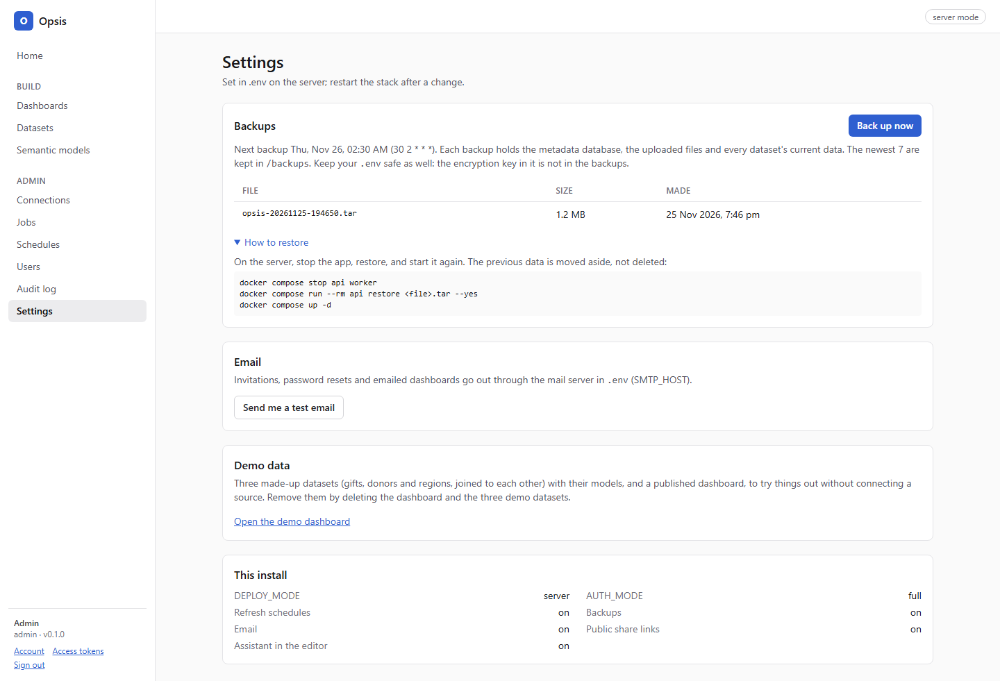

# 9. Running Opsis

[Guide contents](README.md) | Previous: [AI agents and the assistant](08-agents.md)

## Jobs and schedules

Refreshes, backups, loading the demo data and emailed dashboards run as background **jobs**, one at a time, inside the api (laptop) or in the `worker` container (server). **Jobs** lists them with their status, duration and any error.

**Schedules** (when schedules are on) lists everything that runs on its own: dataset refreshes, emailed dashboards, the nightly backup and the nightly clean-up (old sessions, used links, old finished jobs; the audit log is kept).

## Backups and restore

With `FEATURE_BACKUPS=true` (server default), a backup is written every night (`BACKUP_SCHEDULE`, 02:30 by default) to the `backups` volume. The newest `BACKUP_RETENTION` (7) are kept. **Settings** lists them and has **Back up now**.



From a terminal:

```powershell
docker compose exec api python -m opsis backup
```

```powershell
docker compose cp api:/backups/<file>.tar .
```

A backup holds the database (people, connections, models, dashboards and their versions, schedules, audit log), uploaded files and each dataset's current data. **It does not include `.env`.** Keep a copy of `.env` somewhere safe and private: its `ENCRYPTION_KEY` is needed to read the saved connection passwords.

To **restore** (this replaces everything; the previous data is moved aside, not deleted):

```powershell
docker compose stop api worker
```

```powershell
docker compose run --rm api restore <file>.tar --yes
```

```powershell
docker compose up -d
```

Keeping backups on a NAS: see the [Proxmox guide](../../deploy/proxmox/README.md).

## Email

Set `FEATURE_EMAIL=true` with `SMTP_HOST`, `SMTP_PORT`, `SMTP_SECURITY` (`starttls`, `ssl` or `none`), `SMTP_USERNAME`, `SMTP_PASSWORD` and `SMTP_FROM`, then `docker compose up -d`. Check it with **Settings**, **Send me a test email**. Email needs sign-in.

With email on, Opsis sends invitations and password resets, offers **Forgotten your password?**, and lets people choose **Email me** on a dashboard: a schedule on which the dashboard's numbers (a KPI's value, a short table per visual, as that person sees them) arrive with a link. People manage these under **Account**. Messages are never stored.

## Settings

Everything is configured in `.env`; the app's **Settings** page shows what is on. After a change:

```powershell
docker compose up -d
```

Commonly changed:

| Setting | Meaning |
|---|---|
| `WORKSPACE_TIMEZONE`, `WEEK_START`, `FISCAL_YEAR_START_MONTH`, `FISCAL_YEAR_LABEL` | [Calendar](04-semantic-models.md#dates-and-calendars) |
| `MAX_UPLOAD_MB` | Largest CSV or Excel upload (200) |
| `SNAPSHOT_RETENTION` | Copies kept per dataset (3) |
| `QUERY_TIMEOUT_SECONDS`, `QUERY_MAX_ROWS`, `QUERY_MEMORY_LIMIT_MB`, `QUERY_MAX_CONCURRENT` | Query limits (30 s, 10,000 rows, 1,024 MB, 4 at once) |
| `FEATURE_...` | Turn schedules, share links, email, backups and the assistant on or off |
| `APP_NAME` | The name shown in the app |

All settings are in the [README](../../README.md#configuration). Unsafe or contradictory values stop the start with a message naming the setting; check without starting with `docker compose run --rm --no-deps api check-config`.

## Updating, stopping, removing

Make a backup first (**Back up now**), then:

```powershell
git pull
```

```powershell
docker compose up -d --build
```

Database changes are applied when the api starts.

- `docker compose down` stops Opsis and keeps all data.
- `docker compose down -v` **deletes all data**, backups included.

## Useful commands

| Command | What it does |
|---|---|
| `docker compose ps -a` | Services and their health |
| `docker compose logs config-check` | Why the configuration was rejected |
| `docker compose logs api` | The app's log (`worker` for background jobs) |
| `docker compose exec api python -m opsis seed-demo` | Load the demo data |
| `docker compose exec api python -m opsis backup` | Back up now |
| `docker compose exec api python -m opsis reset-link <email>` | A one-time link to set someone's password |
| `docker compose run --rm --no-deps api generate-key` | A new encryption key |

## Troubleshooting

| Symptom | Try |
|---|---|
| The page does not load; an AI client reports "connection refused" | Is Docker running? `docker compose ps -a`, then `docker compose up -d` |
| The stack does not start | `docker compose logs config-check` |
| A refresh fails | The dataset page shows why: see [When a refresh fails](03-datasets.md#when-a-refresh-fails) |
| A dashboard tile shows an error | See [When a visual shows a problem](06-dashboards.md#when-a-visual-shows-a-problem) |
| Totals or counts are too high when grouped or filtered by a joined field | Open the base dataset's model and look for a [warning about a repeated key](05-joins.md#repeated-keys) |
| Scheduled refreshes do not run on a server | Is the `worker` running? |
| The assistant cannot reach a local model | Is Ollama running, and is `OLLAMA_MODEL` pulled? |
| Large uploads fail behind a proxy | Raise the proxy's body limit to at least `MAX_UPLOAD_MB` |

Server-specific problems (proxy, sub-path, Google sign-in, NFS) are in the [Proxmox guide's troubleshooting](../../deploy/proxmox/README.md#12-troubleshooting).

## Current limits

- No raw SQL page. Queries go through semantic models.
- A dataset cannot be edited after creation; recreate it with the same name.
- Joins reach at most two datasets away, only many-to-one or one-to-one; measures come from the base dataset.
- A repeated key in a joined dataset is a [warning on the model](05-joins.md#repeated-keys), not an error: dashboards still show the numbers, too high.
- Row-level security on a joined dataset does not hide rows of the dataset that joins to it. The model [warns](05-joins.md#row-level-security-and-joins) when that dataset has no rules of its own.
- YAML comments in models are not kept.
- Append and merge refreshes do not remove rows deleted in the source until a full rebuild.
- Background jobs run one at a time, so a long refresh delays other jobs.
- Google Sheets refresh in full only.
- Emailed dashboards show numbers and short tables, not chart pictures.
- The model page's query tool takes one filter.
- A dashboard's owner cannot be changed in the app.
- No second sign-in factor.
